<p align="center">
  
</p>

<p align="center">
  <a href="LICENSE">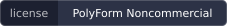</a>
  <a href="#build-from-source"></a>
  <a href="#build-from-source">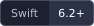</a>
</p>

<p align="center">English | <a href="docs/README.zh-CN.md">简体中文</a></p>

<p align="center">A native macOS window manager with keyboard-driven layouts, cross-app tab groups, and saved workspaces.<br>Built with Swift, AppKit, and SwiftUI. Liquid Glass and Classic appearances.</p>

<p align="center">
  <a href="https://q1ngsong.github.io/Untangle/"></a>
  <a href="https://github.com/Q1ngSong/Untangle/releases/latest"></a>
  <a href="https://github.com/Q1ngSong/Untangle/releases"></a>
  <a href="#quick-start"></a>
  <a href="docs/COMMANDS.md"></a>
</p>

## What's inside

| | |
| --- | --- |
| **Layouts** | Halves, quarters, maximize and center from the keyboard; edge snapping and a drag grid; one-key undo; region collision (Beta). |
| **Tab groups** | Windows from different apps share one tab bar. Click a tab to bring only that window forward. |
| **Workspaces** | Save a desktop's windows, tab groups, browser tabs and editor projects as a board, then reopen it on its own desktop. |
| **Window switcher** | **⌘ Tab** shows every window with a live thumbnail, plus Chrome tabs when you allow it. |
| **Dock previews** | Hover an app's Dock icon to see its windows and click one to bring it forward. |
| **Command search** | Find commands, open windows and saved boards by name, in English, Chinese or pinyin. |
| **Desktops** | Create, remove, switch and clean up desktops; send windows to other desktops and displays. |
| **Menu bar (Beta)** | Sort menu bar icons into colored rows and switch rows from the tray, so the notch never hides them. |
| **Appearance and skins** | Liquid Glass (light or dark) or Classic, a skin workshop that tunes every module, and 18 ready-made skin packages. |
| **Settings** | Your own leader key and shortcuts; move everything to a new Mac as one zip. |

## Quick start

1. Put `Untangle.app` in Applications and open it.
2. In **Settings → Diagnostics → Permissions**, enable **Accessibility** for window control and global input. Enable **Screen Recording** for window thumbnails. Untangle opens Diagnostics on first launch if Accessibility is missing.
3. Focus a window. Hold **right Command**, then press **←** to place it on the left half of the screen. Keep holding the leader key while entering a sequence.
4. Open **Settings → Shortcuts** to choose your leader key, search or filter commands, and record custom shortcuts. **Record** previews your input; **Save** keeps it; **Esc** cancels an unsaved recording.

Choose **Follow System**, **简体中文**, or **English** in **Settings → General → Language**. Changes apply immediately. Command search accepts both English and Chinese names, including pinyin.

The sequences below use the defaults. Your saved shortcuts take precedence. Independent shortcuts, such as **⌘ Tab** for the window switcher, do not need the leader key.

## Layouts: arrange windows from the keyboard


*The animations are illustrated walkthroughs, not screen recordings. Actual window contents and materials depend on your apps and system appearance. Reduce Motion shows a still frame.*

### Halves from the keyboard

> Before: dragging a window's edge pixel by pixel, and it never quite lines up.

Hold the leader key and press **←** to put the window on the left half; **→ ↑ ↓** work the same way. **F** maximizes and **C** centers.

After a layout command, Untangle waits a moment for the next key. Press **←** again and the window steps from 1/2 to 1/3 to 2/3 of the screen and back. Set the wait in **Settings → Shortcuts**.

### Four corners

> Before: four windows piled on top of each other.

Hold the leader key and press **U / I / J / K** to put windows in the top-left, top-right, bottom-left and bottom-right quarters.

| While holding the leader key | Action |
| --- | --- |
| **← / → / ↑ / ↓** | Left, right, top or bottom half |
| **U / I / J / K** | Top-left, top-right, bottom-left or bottom-right quarter |
| **F** | Maximize |
| **C** | Center |
| **Z** | Go back to the previous position |
| **Space** | Open command search |

### Drag snapping and the grid

> Before: macOS tiles only into halves; a third of the screen is out of reach.

Drag a window to a screen edge to snap it. Hold the grid modifier (Option by default) while dragging and a grid appears; the window takes as many cells as you cover. Choose the grid's rows and columns in **Settings → Layout**.

The gap between windows and the animation length are set there too. With Liquid Glass, the snap preview can be a real glass pane. If macOS's own drag-to-tile settings are on, Layout names the ones that overlap with Untangle and opens Desktop & Dock settings for you.

### Go back

> Before: one slip and the window's old place is gone.

Hold the leader key and press **Z** to put the window back where it was. **Z** also undoes a tab moved to the wrong group and a region boundary dragged too far.

### Region collision (Beta)

> Before: widen the left window and it covers part of the right one.

With this on, resizing a window makes the windows touching it give way or close up along the shared edge. Halves, corners and edge snaps then fill the regions those edges mark out, and **Z** takes the whole boundary back. Off by default; turn it on in **Settings → Layout**.

## Tab groups: keep related apps together


### Cross-app tab groups

> Before: browser, notes and documents stacked up, and you dig through them one by one.

Windows from different apps share one tab bar and one place on screen. Click a tab and only that window comes forward; the app's other windows stay where they are.

There are four ways to make a group:

- Hold the leader key and enter **T, T** to group the windows under the focused one. A window joins when the overlap covers more than 85% of its area or the focused window's area; edges need not line up.
- Enter **T, A**, then click any window to add it.
- Snap or place a window exactly onto the area another window or group occupies; once it settles, they become one group. Turn this on or off in **Settings → Tab groups**.
- Hold **⌘** and drag a window onto a tab bar.

### Drag out, drag in, put back

> Before: a window in the wrong group meant ungrouping everything and starting over.

| Keys or gesture | Action |
| --- | --- |
| **[** / **]** | Previous / next tab |
| **T, digit** | Jump to tab N |
| Drag a tab | Reorder it, drop it on another group's bar, or drag it out to make it a window again |
| **⌘**-drag a window | Detach it from its group |
| **T, X** | Take the focused window out of its group |
| **T, U** | Ungroup all windows |
| Leader, then **Z** | Put a moved or removed tab back into its group |

Tab bars hide while Mission Control, App Exposé or Show Desktop is open. Set the bar's height, spacing and width in **Settings → Tab groups**, and its look in the skin workshop.

[Find all tab-group commands](docs/COMMANDS.md) →

## Finding windows: the one you need, right away


### Window switcher

> Before: macOS's ⌘Tab shows app icons only, so three windows of one app look the same.

**⌘ Tab** switches between every window, each shown as a card with a live thumbnail. **⌘ `** stays within the current app; add **⇧** to go backwards.

Minimized windows show their last picture without being restored. Choose a single scrolling row or several rows, the thumbnail height, and whether minimized windows are listed.

### Chrome tabs, one step away

> Before: the tab is hidden in some Chrome window, and you still have to find it after switching there.

Turn on **Settings → Pages** and a Chrome window's tabs appear under its card in the switcher: press **↓ ↑** to pick one and release to go there. Chrome switches without reloading the page. Each tab is also its own command-search result. Untangle needs permission to read the tabs' titles and addresses; incognito windows are never listed.

### Command search


> Before: shortcuts forgotten, and the feature buried somewhere in the menus.

Hold the leader key and press **Space**, then type a command such as "left half", an app name, a window title or a board name. English, Chinese and pinyin all match, including pinyin initials: `zbp` finds 左半屏. Use **↑ ↓** and Return, or click a result; **Esc** returns to your window.

Each command shows its key sequence, so search doubles as a way to learn the shortcuts.

### Key hints

> Before: holding right ⌘ and forgetting which key comes next.

Press the leader key and a hint panel lists the keys that can follow: ← left half, F maximize, T tab groups, D desktops, W workspaces, Z go back… Change the leader key and every shortcut in **Settings → Shortcuts**.

## Dock previews: see the window before you click


> Before: hovering a Dock icon shows nothing but the app's name, and clicking brings up the wrong window.

### Hover previews

Rest the pointer on a Dock icon and every window of that app appears as a thumbnail; click one to bring that window forward. Previews open beside the Dock, whether it sits on the left, the right or the bottom.

- **Minimized windows** get a thumbnail too, showing their last picture without being restored.
- **Current desktop only:** windows on other desktops are left out.
- **Single-window apps** can be previewed or skipped.
- **Show and hide delays** are separate, so sweeping across the Dock does not make previews flicker.
- **Animation:** previews fade in and slide gently out of the Dock, follow smoothly between icons, and fade out; with Reduce Motion they simply appear.
- **Hide the Dock's own labels** so the system name tag does not sit on top of a preview (Dock magnification turns off with it).

### Settings and permissions

Adjust all of this in **Settings → Dock Preview**; the cards' look is set in the skin workshop. Thumbnails need **Screen Recording** permission; without it they stay empty and everything else still works.

## Desktops: no trip to Mission Control


### Manage desktops quickly

> Before: a new desktop meant opening Mission Control and finding the + in the corner.

| Leader, then | Action |
| --- | --- |
| **D, N** | Create a desktop and switch to it |
| **D, X** | Remove the current desktop |
| **D, digit** | Jump to desktop N |
| **D, [** / **D, ]** | Switch to the desktop on the left / right |

In **Settings → Layout** you can also let Untangle handle **⌃←**, **⌃→** and **⌃ digit**, so desktops switch without waiting for the system animation.

### Send windows elsewhere

> Before: dragging a window into the screen edge and waiting for the next desktop to slide in.

| Leader, then | Action |
| --- | --- |
| **S, digit** | Send the focused window to desktop N |
| **S, ←** / **S, →** | Send it to the desktop on the left / right |
| **D, ← / → / ↑ / ↓** | Send it to another display |

### Clean up empty desktops

> Before: seven desktops, half of them empty.

Hold the leader key and enter **D, C** to remove every empty desktop at once. Hidden and minimized windows do not count as content; each display keeps at least one ordinary desktop, and desktops whose state cannot be read are kept.

### Mission Control, already expanded (Beta)

> Before: Mission Control shows a row of desktop names, and you have to move the pointer up to expand it.

With this on, **⌃↑** or a trackpad swipe up opens Mission Control with the desktop thumbnails already expanded, without moving the mouse; swipe down or press **⌃↑** again to leave. Off by default; turn it on in **Settings → Layout**.

## Workspaces: tomorrow, exactly as you left it today


### Restore a board in one step

> Before: every morning, reopening and rearranging a dozen windows.

A board is one desktop on one display. It saves window positions and sizes, Untangle tab groups, Chrome and Safari tabs, and local VS Code files and projects.

Hold the leader key and enter **W, digit** to open a board. Untangle gives it its own desktop, starts missing apps, opens the recorded files and pages, moves windows over, rebuilds tab groups, and reports anything that did not arrive. An open board just switches to its desktop.

- **Checkpoints:** **W, S** saves the current state, **W, R** goes back to it.
- **Autosave:** runs on an interval you choose, and also when you leave, release or quit; an empty desktop never overwrites a checkpoint.
- **Focus on open:** click a window or tab in the layout preview to choose what is in front when the board opens.
- **Lock:** a locked board's saved contents and layout are never overwritten.
- **Trash:** deleted boards stay for 7 days and can be restored.
- **Release:** **W, X** unbinds a board from its desktop.

Browser access needs Automation permission. Unsaved edits, browser profiles and remote editor sessions are not backed up.

### Board list

> Before: several desktops open, and no memory of which one is for what.

Press **⌥W** (or leader, then **W, Space**) to list every board with its layout preview on the left. An open board switches to its desktop; a closed one gets a new desktop and is restored. Drag boards in **Settings → Workspaces** to change their numbers.

[Learn the workspace commands](docs/COMMANDS.md) →

## Menu bar (Beta): more icons than the notch allows


> Before: with many menu bar icons, the ones on the right disappear behind the notch.

### Sort icons into rows

In **Settings → Menu bar · Beta**, put your menu bar icons into rows 1, 2, 3 and so on. The menu bar shows one row at a time and tucks the others away; switch to the row you need.

- **Drag into a row:** drag a found item onto a row in Settings, or hold **⌥⌘** and drag an icon from the menu bar into a row of the tray. The same icon can sit in several rows.
- **Always-visible icons:** drag an icon back to the menu bar and it stays shown whatever row is active.
- **A color per row:** give each row a background color (amber, blue, clay, graphite, green, indigo, purple or rose) to see at a glance which row is showing.
- **Add and remove rows** at any time; icons that only lived in a removed row return to the menu bar.

### Switch with the tray

- **Right-click** Untangle's menu bar icon, or press **⌥M**, to open the App tray.
- In the tray, press **1–9** to pick a row or **Tab** for the next one, or just click.
- Command search has "Switch to next menu bar row" and "Open menu bar tray", so you can bind your own shortcuts.

### When something goes wrong

- Rearranging the menu bar borrows the mouse for a moment, and a notice asks you not to move it.
- An unfinished switch is retried once; if it still fails, all icons are shown and **↺ Rearrange** fixes it. **Rebuild** in Settings goes further: every icon returns to the menu bar and is placed again from your rows, which are kept.
- Quitting Untangle restores the menu bar as it was.

Requires macOS 26 with Accessibility and Screen Recording permission.

## Appearance and skins: make it look the way you like


> Before: a utility that looks like every other one and clashes with the system.

### Built-in appearances

Choose in **Settings → General → Appearance**:

- **Liquid Glass:** macOS 26 glass; a bright lens rises on the selection and springs between cards, rows and tabs.
- **Classic:** Untangle's original look for overlays and settings pages. The settings window and its sidebar stay glass in every appearance.
- **Light or dark:** shown with Liquid Glass. Follow the system, or pick light or dark; all of Untangle follows, and Liquid Glass overlays and tab bars switch to the matching light or dark lens. The choice stays in effect when you switch to another appearance.

Reduce Motion and Increase Contrast are respected: the first turns animations off, the second outlines selected cards and tabs.

### Skin workshop

Choose **Workshop** under Appearance, then build your own skin module by module in **Settings → Skin workshop**. The modules are the switcher, tab bar, Dock preview, search panel, key hints and toasts, and each can be tuned separately:

| What you can change | Options |
| --- | --- |
| Template | Glass, minimal, cyberpunk |
| Panel outline / card shape | Rounded, chamfered or square; the tab bar also offers a parallelogram with an adjustable slant |
| Colors | Accent, hover, background opacity, selected text color |
| Selection marker | Left stripe, underline, corner marks, top bar, or none |
| Selection highlight | Strength of the highlight fill and border |
| Thumbnails | Upright, clipped to the card shape, or slanted with it; thumbnail inset |
| Titles | Above or below the thumbnail, leading or centered, size, weight, app icon on or off |
| Spacing | Panel padding and card spacing (compact, standard, roomy) |
| Motion | Highlight motion (none, gentle, lively) and speed (slow, standard, fast) |

**Export theme** saves the whole look as one file to share; importing a theme changes only the look and keeps shortcuts and other settings.

### Skin packages

A skin package is a `.untangleskin` file that holds only data, so it installs without an App update: choose or drop it under **Import theme or skin** in the skin workshop, or double-click it in Finder. Importing a newer version of the same package updates it and keeps your per-module adjustments; deleted packages go to the Trash.

Ready-made packages live in [`skins/`](skins/):

| Family | Packages | Look |
| --- | --- | --- |
| Liquid Glass | Liquid Glass Lens, Liquid Glass Lens Dark | Light or smoky dark glass with a two-line rim and a glowing lens on the selection |
| Hand-drawn | Pen | Pen sketch on white paper: wobbly double lines, crossed corners, hatched selection shadow |
| | Pencil | Pencil on a dot-grid notebook, a grey highlighter on the selection, washi tape on thumbnails |
| Pixel | Blocks | Light stone bevels, sunken item slots, a white selection frame |
| | Neon | Rounded neon tubes in a dungeon style |
| | Countryside | Parchment, double wooden frames, an orange-red cursor box |
| Cats | Cream Cat, Night Cat | Milk-tea or plum night, pink paw pads, cat ears peeking over the selected card |
| Penguins | Glacier Penguin, Polar Night Penguin | Ice white or deep blue night, a little penguin sitting on the card corner |
| Panda | Bamboo Panda | Cream, ink black and bamboo green; the selected card becomes a panda face |
| Bunnies | Strawberry, Lavender and Caramel Bunny | Cream and strawberry pink, light lavender, or caramel; icons grow bunny ears |
| Dog | Shiba | Persimmon orange, upright ears and a wagging curled tail |
| Bears | Honey Bear, Cocoa Bear | Honey yellow or hot cocoa, round ears, honey dripping along the panel edge |

## Move to another Mac

> Before: a new Mac meant recording every shortcut and arranging every board again.

In **Settings → Diagnostics**, export preferences, shortcuts, skin packages, boards (with their trash) and menu bar rows as one zip, import it on the new Mac, then reopen Untangle. Permissions, launch at login, caches, unsaved changes and live windows are not included; imported boards are unbound from their old desktops until you open them. The file contains the paths and addresses your boards recorded, so keep it safe.

## More settings

- **Leader key:** right Command by default. Record right Ctrl, any single key, or a chord such as Control–Option–K instead.
- **Shortcuts:** search every command, record your own key sequences or global shortcuts, and see conflicts before you save.
- **Launch at login and language** are in **Settings → General**; **software updates** are in **Settings → Diagnostics**.

Learn the [complete command sequences](docs/COMMANDS.md), or read the [macOS behavior notes](docs/COMMANDS.macos.md) for system integration and limitations.

## Guides

| Guide | What you will learn |
| --- | --- |
| [Command reference](docs/COMMANDS.md) | All commands, default leader sequences, independent shortcuts, and which window each command targets. Start here when learning the keyboard workflow. |
| [macOS behavior notes](docs/COMMANDS.macos.md) | How Untangle is designed, and every macOS API it uses (public, Accessibility, Apple Events and private) for windows, desktops, the menu bar, browsers, skins and updates, with measured evidence and limits. |

## Build from source

This guide describes the current Untangle App. Public application source remains at **0.0.1**, under its original **Tangler** name. Building that snapshot does not reproduce the current release features.


Requires macOS 26+, **Swift 6.2+**, and the corresponding macOS SDK. Run from the repository root:

```sh
TANGLER_SIGNING_IDENTITY=- scripts/build-app.sh  # Explicit ad-hoc test build: build/Tangler.app
```

Maintainer builds and releases require the fixed certificate pinned in `Configuration/signing.json`; its private key is not included in source. The command above explicitly opts into an ad-hoc build for your own testing, which may require granting privacy permissions again after rebuilding. There is no silent fallback to ad-hoc signing, and the installer and release packager reject it. An Apple Developer account is not required. Current builds are not notarized; if macOS blocks a downloaded build, verify its origin and follow [Apple's opening instructions](https://support.apple.com/en-us/102445).

Downloads and release notes live on [GitHub Releases](https://github.com/Q1ngSong/Untangle/releases). In **Settings → Diagnostics → Software Update**, check for a new version and choose manual checks, automatic checks with a notification, or automatic downloads and installation. The default checks every 6 hours and asks before installing; automatic installation usually happens when you quit. In-app updates use Sparkle and require a configured production update public key and a published update feed.


## License

[PolyForm Noncommercial 1.0.0](LICENSE). Noncommercial use, modification, and redistribution are permitted within its terms. **Commercial use is not authorized, including internal business use by for-profit companies.** This is source-available software under a noncommercial license.

See [LICENSE](LICENSE) for the complete terms and [NOTICE](NOTICE) for third-party licenses.
