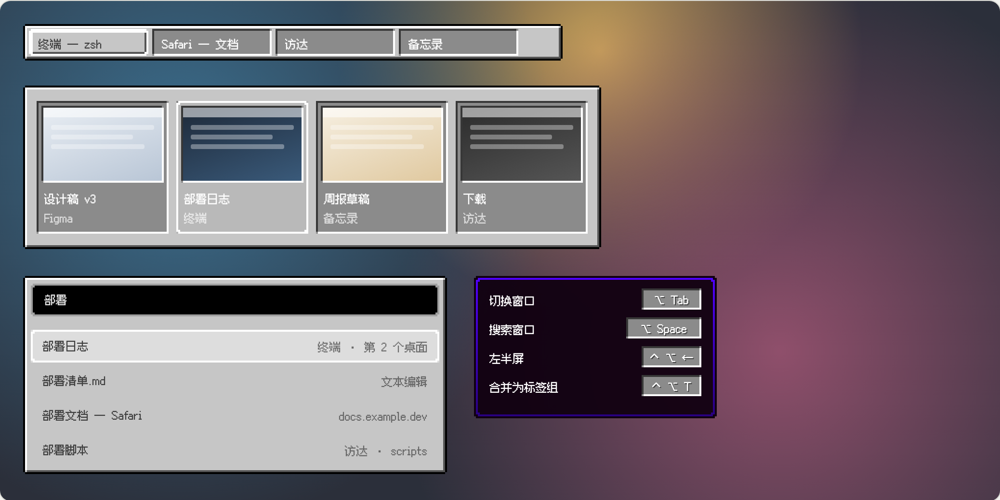
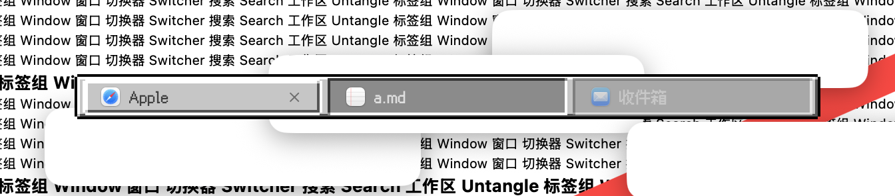
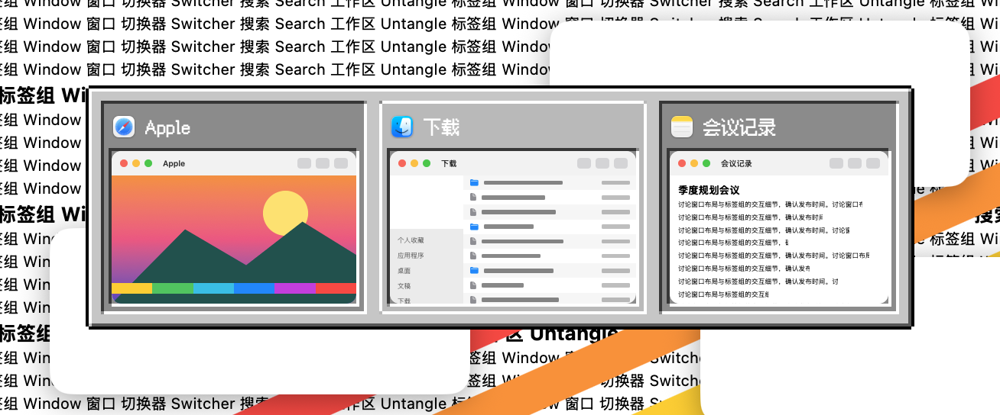
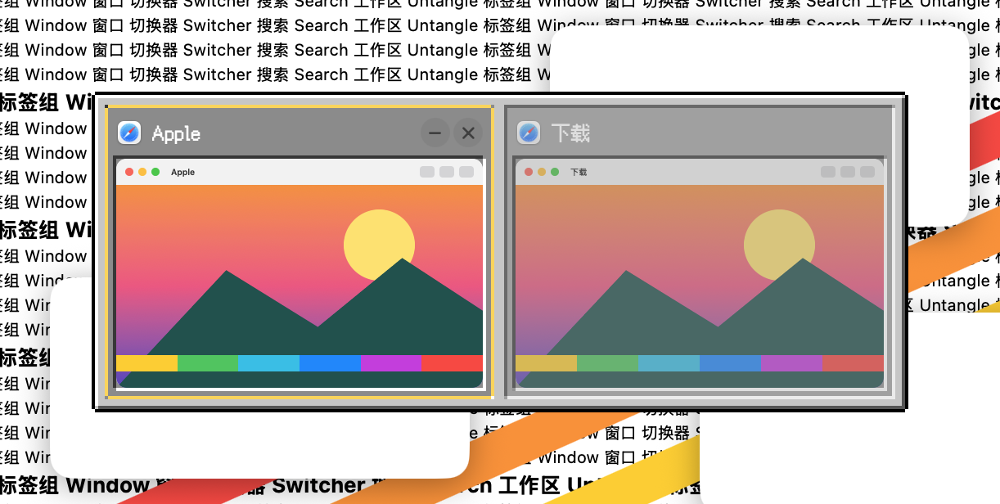
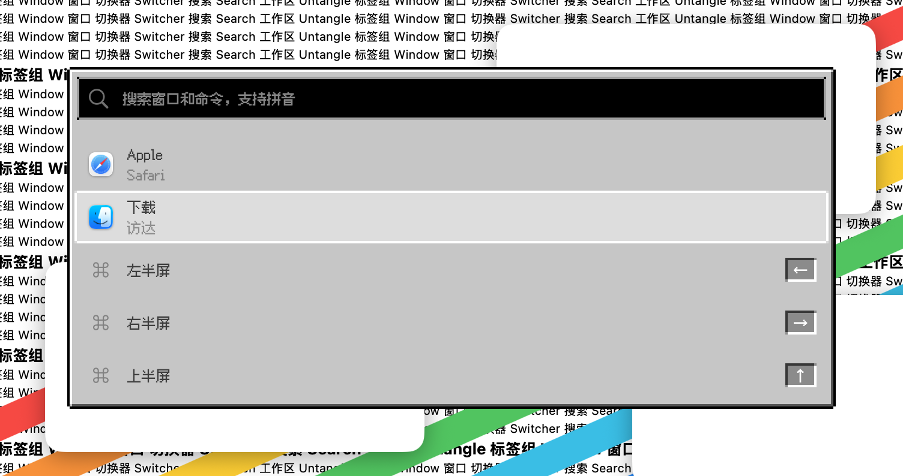
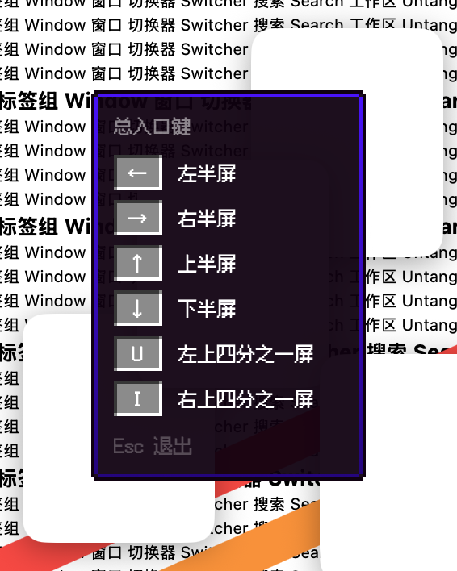
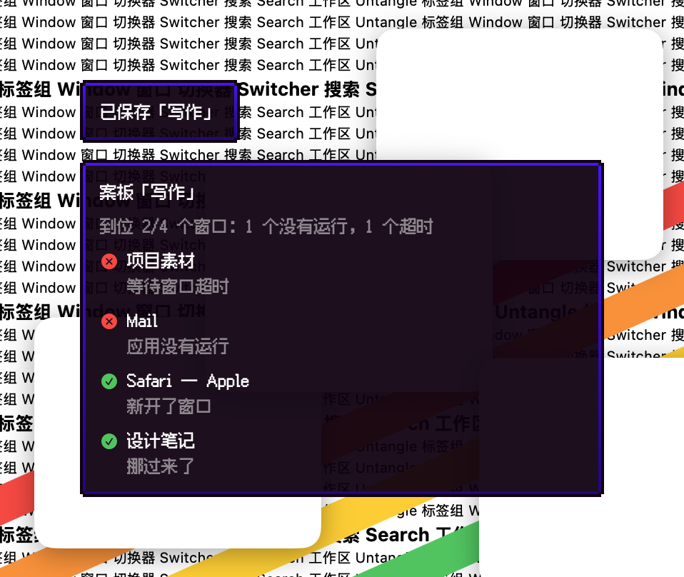

# 像素·方块 · 2026-10-23

**定位**：方块游戏界面的浅灰石板：立体斜边、凹进去的物品格、白色选中罩、深紫说明框。最有辨识度的一套。只借风格，不用游戏的名字、贴图或标志。

## 配色

| 项 | 值 |
|---|---|
| 面板 | `#c6c6c6`，亮边 `#ffffff`，暗边 `#555555`，外框 `#000000` |
| 文字 | `#3f3f3f`；格子里 `#ffffff` |
| 格子 | `#8b8b8b`，凹边 `#373737` / `#ffffff` |
| 选中 | 亮色 40% 白，边框 `#ffffff` |
| 悬停边框 | `#fcd34d` |
| 说明框 | 底 `#100010`（94%），边 `#5000ff` → `#28007f` |
| 搜索框 | 黑底，字 `#e0e0e0`，边 `#a0a0a0` |

## 像素系列共用的规则

- **网格**：2 点一格；所有边都按整数格画，全部直角，外框的四个角各缺一格。
- **立体感**：凸起的面（面板、当前标签）左上亮、右下暗；凹进去的格子（卡片、行、键帽、未选中的标签）反过来。
- **选中**：格子底下垫一层亮色，外面一圈选中色边框（强调色，可在工坊里改）；悬停是一格宽的悬停色边框。选中框在格子之间直接跳，不滑动。
- **字体**：内置 Fusion Pixel 12px（简体中文，SIL OFL 1.1），固定 12 点，中英文都是像素字；字体加载失败时退回系统字体。
- **缩略图**：窗口画面保持清晰、方角，只有它所在的格子是像素边框。
- **快捷键提示、提示浮窗**：做成说明框：深色纸条、一格自身色外框，内边一格从上到下渐变。
- **增强对比度**：选中边框加粗一格，非当前标签不淡化。
- **工坊里**：外形、切角、发光、动效、卡片外形、选中标记和字号这些选项对像素皮肤不适用，会自动隐藏。

## 代码

`Sources/OverlayKit/PixelSkin.swift`（调色板、立体边框、格子、说明框、字体注册与 `overlayFont`），模板在 `TabBarTheme.swift`，字体在 `Sources/CoreKit/Resources/Fonts/`。

## 皮肤包渲染

`package/` 是按 [皮肤包格式](../FORMAT.zh-CN.md) 写成的示例包。下图由网页预览器直接读取 `package/skin.json`、素材图和像素字体画出，不是 App 截图：标签栏、切换器、搜索面板、快捷键提示；当前标签、第二张卡片和第一行处于选中状态。

## 截图（App）

