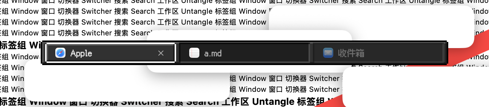
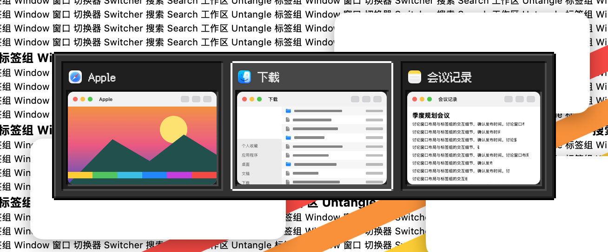
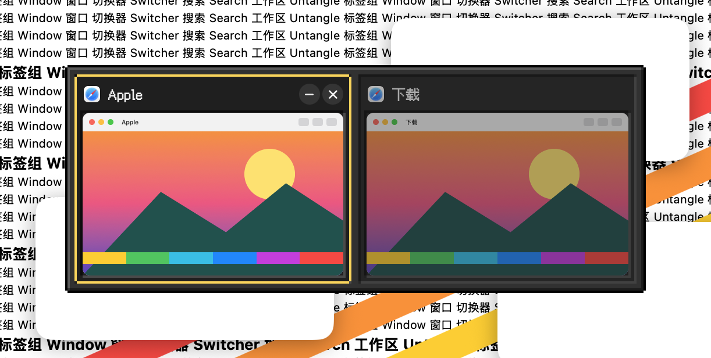
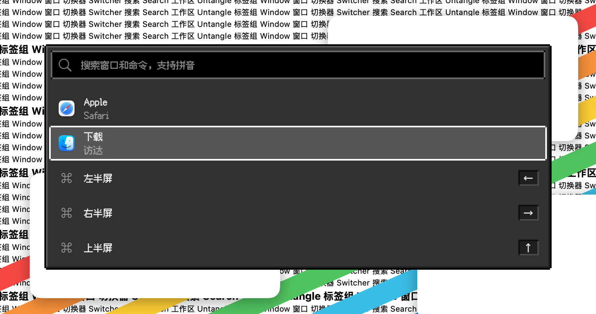
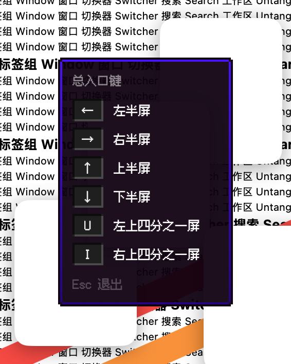
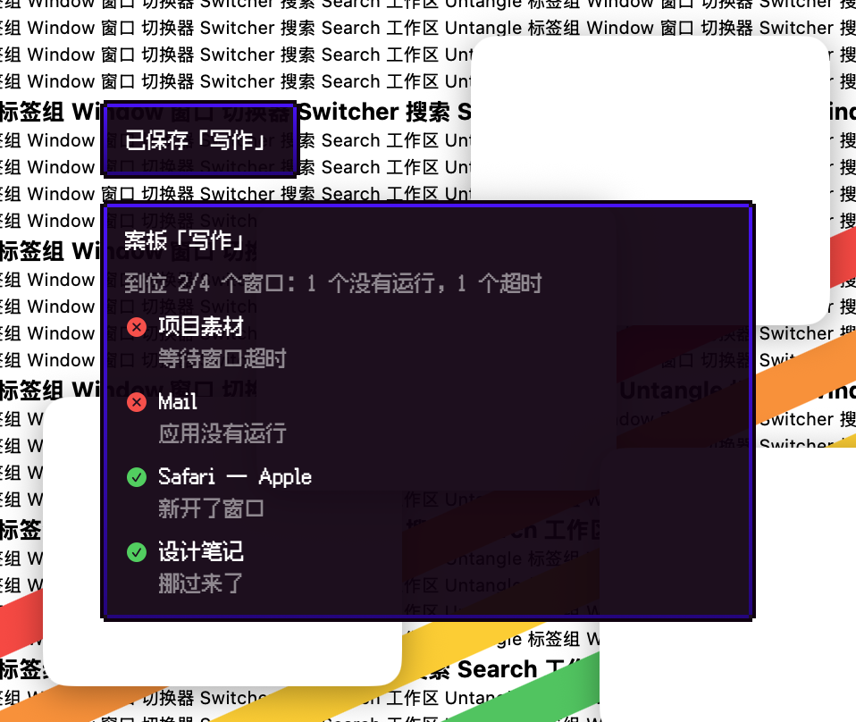

# 像素·方块（夜）· 2026-10-23

**定位**：像素·方块的夜间版：深灰石板，同样的立体边和物品格，晚上不刺眼。

## 配色

| 项 | 值 |
|---|---|
| 面板 | `#313131`，亮边 `#5a5a5a`，暗边 `#1c1c1c`，外框 `#000000` |
| 文字 | `#f0f0f0` |
| 格子 | `#1f1f1f`，凹边 `#0c0c0c` / `#4a4a4a` |
| 选中 | 亮色 18% 白，边框 `#ffffff` |
| 悬停边框 | `#fcd34d` |
| 说明框 | 同方块：`#100010`，边 `#5000ff` → `#28007f` |
| 搜索框 | 黑底，字 `#e0e0e0`，边 `#6a6a6a` |

## 像素系列共用的规则

- **网格**：2 点一格；所有边都按整数格画，全部直角，外框的四个角各缺一格。
- **立体感**：凸起的面（面板、当前标签）左上亮、右下暗；凹进去的格子（卡片、行、键帽、未选中的标签）反过来。
- **选中**：格子底下垫一层亮色，外面一圈选中色边框（强调色，可在工坊里改）；悬停是一格宽的悬停色边框。选中框在格子之间直接跳，不滑动。
- **字体**：内置 Fusion Pixel 12px（简体中文，SIL OFL 1.1），固定 12 点，中英文都是像素字；字体加载失败时退回系统字体。
- **缩略图**：窗口画面保持清晰、方角，只有它所在的格子是像素边框。
- **快捷键提示、提示浮窗**：做成说明框：深色纸条、一格自身色外框，内边一格从上到下渐变。
- **增强对比度**：选中边框加粗一格，非当前标签不淡化。
- **工坊里**：外形、切角、发光、动效、卡片外形、选中标记和字号这些选项对像素皮肤不适用，会自动隐藏。

## 代码

`Sources/OverlayKit/PixelSkin.swift`（调色板、立体边框、格子、说明框、字体注册与 `overlayFont`），模板在 `TabBarTheme.swift`，字体在 `Sources/CoreKit/Resources/Fonts/`。

## 截图

