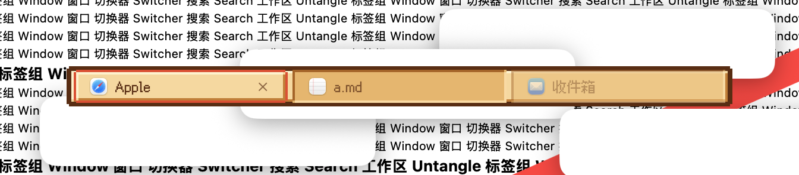
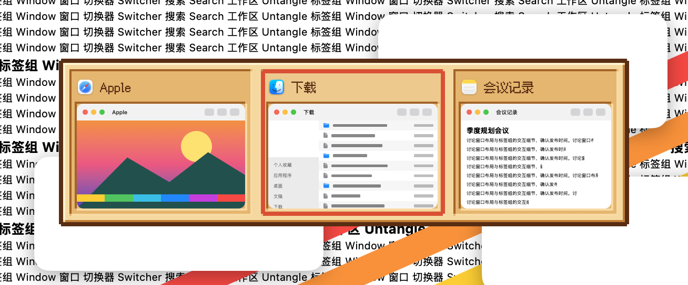
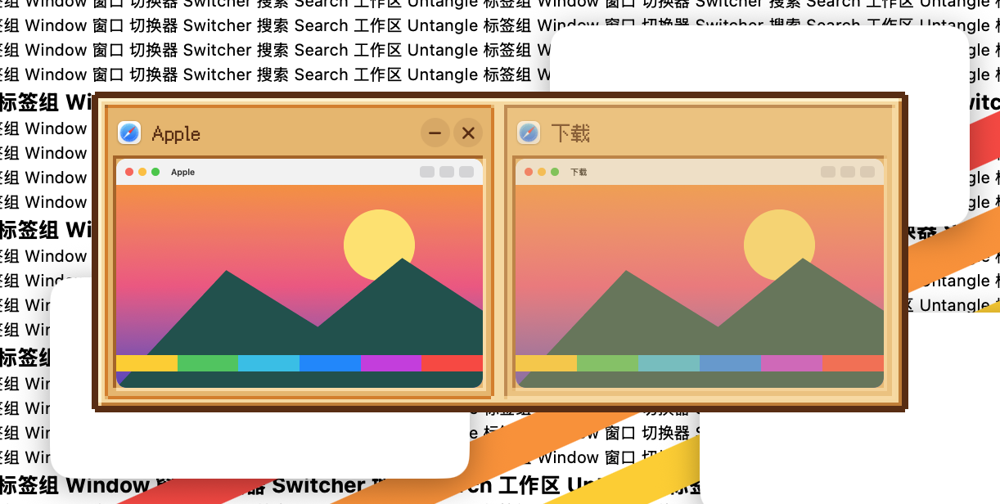
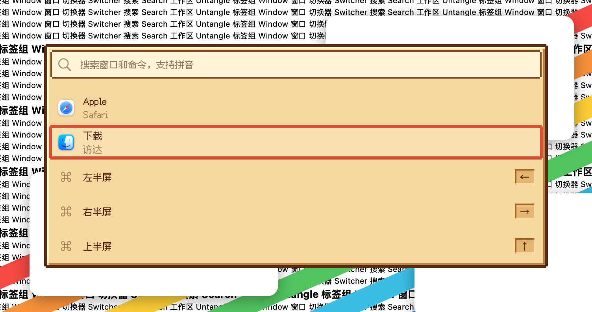
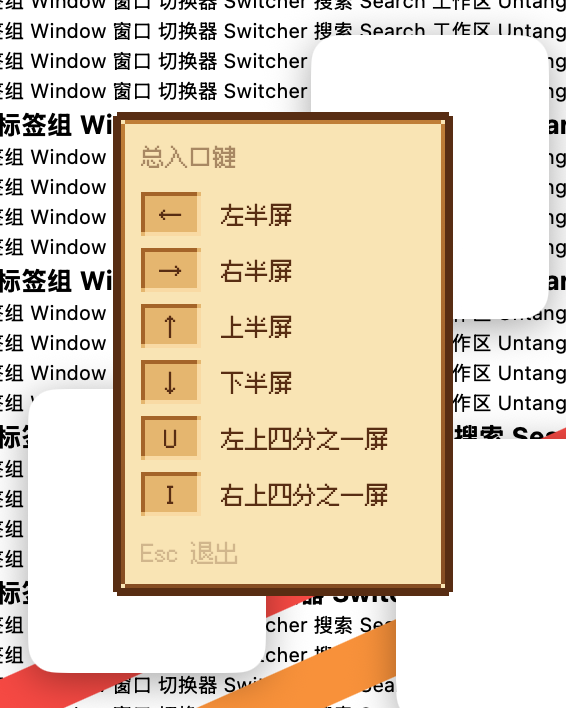
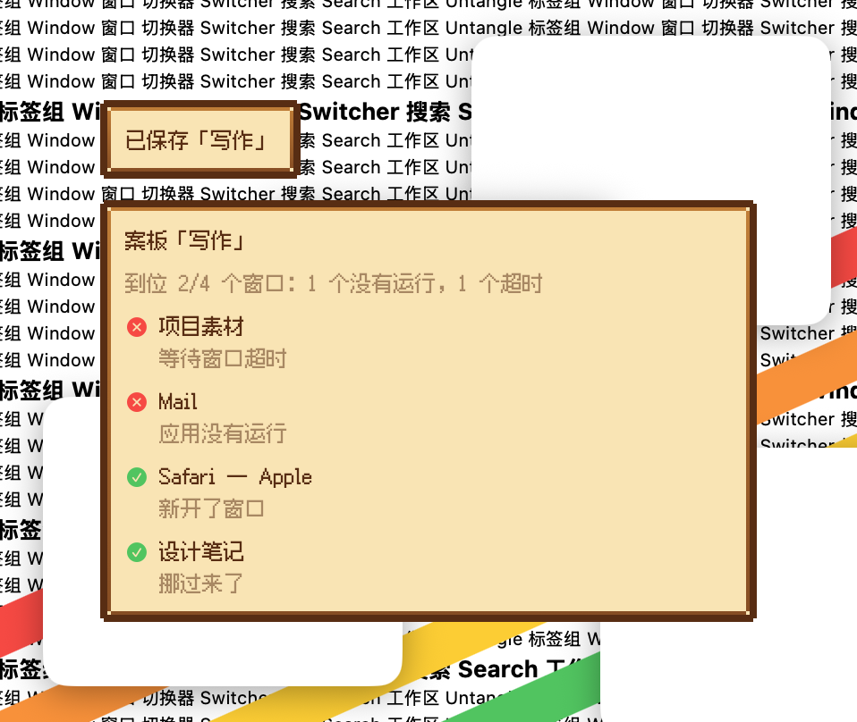

# 像素·田园 · 2026-10-23

**定位**：农场游戏的木框与羊皮纸：暖黄纸面、木褐色双格粗边框、红橙色光标框，提示是奶油色纸条。温暖安静。只借风格，不用游戏的名字、贴图或标志。

## 配色

| 项 | 值 |
|---|---|
| 面板 | `#f7d79c`，亮边 `#fff2cc`，暗边 `#c57b2d`，外框 `#5b2b0f`（两格粗） |
| 文字 | `#5b2b0f` |
| 格子 | `#e9b468`，凹边 `#a8611f` / `#fbd9a0` |
| 选中 | 亮色 30% 奶油，边框 `#e2462b`（两格粗） |
| 悬停边框 | `#d97a1b` |
| 说明框 | 底 `#fbe4b0`，外框 `#5b2b0f`，边 `#c57b2d` → `#8a4a1c` |
| 搜索框 | 底 `#fff4d6`，字 `#5b2b0f`，边 `#8a4a1c` |

## 像素系列共用的规则

- **网格**：2 点一格；所有边都按整数格画，全部直角，外框的四个角各缺一格。
- **立体感**：凸起的面（面板、当前标签）左上亮、右下暗；凹进去的格子（卡片、行、键帽、未选中的标签）反过来。
- **选中**：格子底下垫一层亮色，外面一圈选中色边框（强调色，可在工坊里改）；悬停是一格宽的悬停色边框。选中框在格子之间直接跳，不滑动。
- **字体**：内置 Fusion Pixel 12px（简体中文，SIL OFL 1.1），固定 12 点，中英文都是像素字；字体加载失败时退回系统字体。
- **缩略图**：窗口画面保持清晰、方角，只有它所在的格子是像素边框。
- **快捷键提示、提示浮窗**：做成说明框：深色纸条、一格自身色外框，内边一格从上到下渐变。
- **增强对比度**：选中边框加粗一格，非当前标签不淡化。
- **工坊里**：外形、切角、发光、动效、卡片外形、选中标记和字号这些选项对像素皮肤不适用，会自动隐藏。

## 代码

`Sources/OverlayKit/PixelSkin.swift`（调色板、立体边框、格子、说明框、字体注册与 `overlayFont`），模板在 `TabBarTheme.swift`，字体在 `Sources/CoreKit/Resources/Fonts/`。

## 皮肤包渲染

`package/` 是按 [皮肤包格式](../FORMAT.zh-CN.md) 复刻本方案的皮肤包，打成 `.untangleskin` 后可在皮肤工坊导入。下图由 App 的皮肤包引擎读取 `package/` 画出，不是内置皮肤的截图：标签栏、切换器、搜索面板、快捷键提示；当前标签、第二张卡片和第二行处于选中状态。

和内置皮肤逐像素对照过：同一视图、同一状态各画一次再相减，覆盖标签栏（常规、窄、只有图标、悬停、拖入、拖入提示环、增强对比度）、切换器（含悬停和增强对比度）、Dock 预览、搜索面板（含输入文字）、快捷键提示（含停留变淡）、提示浮窗、卡片按钮和拖出的标签。面板、格子、两格粗的选中框、悬停框、说明框、搜索框、键帽、文字和标签上的 × 都一致；元素落在半点位置时，个别描边转角有一个像素的抗锯齿略有不同。动效逐帧录过：切换标签、移动卡片选中、悬停、拖动标签让位和拖入提示环都和内置一样直接跳。

## 截图（App）

