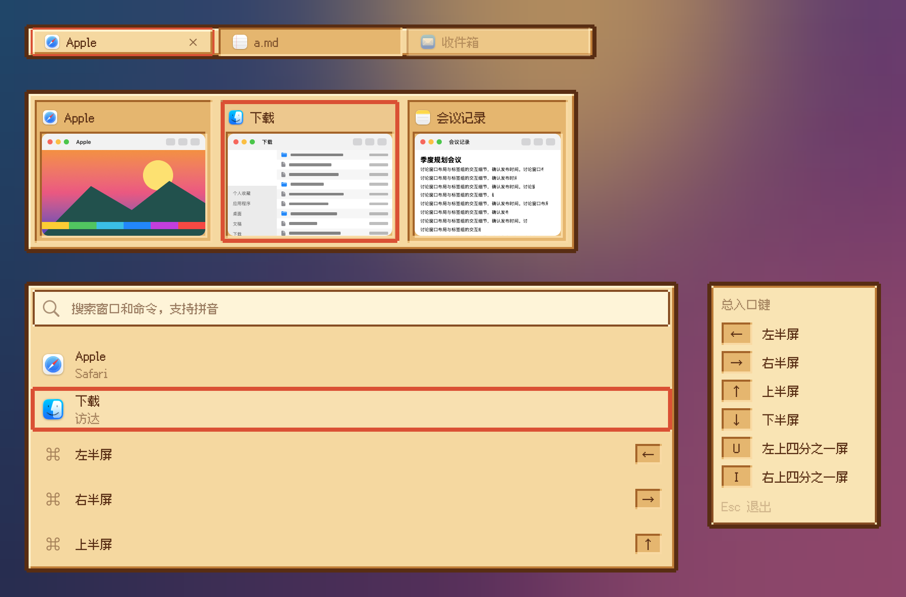

# 像素·田园 · 皮肤包

格式见 `../../FORMAT.zh-CN.md`。这个包照着 App 内置的像素·田园画（`Sources/OverlayKit/PixelSkin.swift`），颜色、格子和线宽逐项一致：

- `assets/panel.png`（10×10）：两格粗的木褐外框（只缺最外一个角格）、奶白亮边、褐色暗边的羊皮纸面板，标签栏也用它；`assets/raised.png`（6×6）：没有外框的凸起面，当前标签用；`assets/slot.png`（6×6）：凹进去的格子，卡片、标签、键帽和缩略图底座用。
  素材 1 像素 = 2 点 = 网格 1 格，按九宫格拉伸，保持锐利。
- 选中框、悬停框用描边画，不画进图片，所以工坊里改颜色立即生效。描边先画成方框，元素的缺角外形（`notched`）再去掉最外的角格；格子和凸起面的图片用自己的方形外形、不受元素外形裁剪（`"shape": {"kind": "rect"}`、`"clip": false`），角上露出格子的颜色，和内置一样。
- 选中：格子上垫一层 30% 的奶油色，外面两格红橙色框；当前标签是凸起的面加一格红橙色外框；悬停是一格橙色框。
- 说明框（快捷键提示、提示浮窗）：奶油色纸条、两格木褐外框、一格从褐色渐变到深褐的内边；内边的四个角格露出纸条。纸条不透明，所以角格直接用纸条颜色的小方块（`box`）盖住。快捷键提示停留变淡时，纸条连同木框一起变淡（`"dimmed": "panel"`）。
- 搜索框：奶油色底、一格深褐边（`bevel` 亮暗同色），四个角格露出底色。
- 卡片上的关闭、最小化按钮：和内置一样是淡色圆底，悬停时换成橙色淡底。
- 字体：`fonts/FusionPixel-12px-Proportional-zh_hans.otf`，固定 12 点；授权见 `LICENSE-*.txt`（SIL OFL 1.1）。
- 动效：和内置像素皮肤一样，状态切换直接跳格；没有滑动和动画。标签栏里拖动标签让位、拖入提示环出现也直接跳，因为引擎跟随标签选中的过渡（`steps`）。
- 增强对比度：选中框加粗一格（三格），当前标签外框两格，拖入提示环三格；面板和说明框不变。
- 标签上的 ×：用顶层 `title` 的木褐色，和内置一样。
- 工坊可调：选中框、悬停框颜色。

按本包画出的样子：

打包：在本目录执行 `zip -q -r -X ../像素田园.untangleskin . -x '.*'`。
