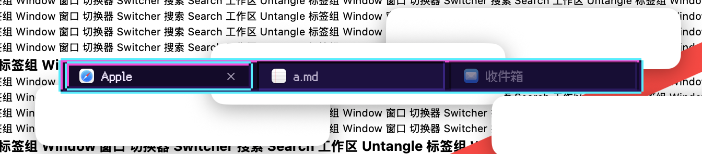
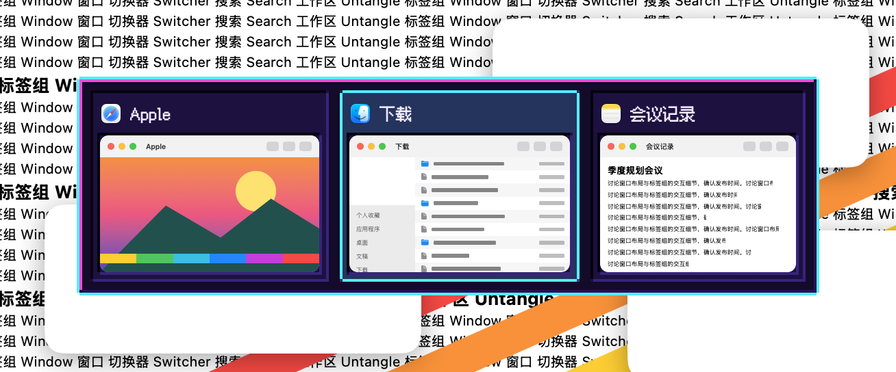
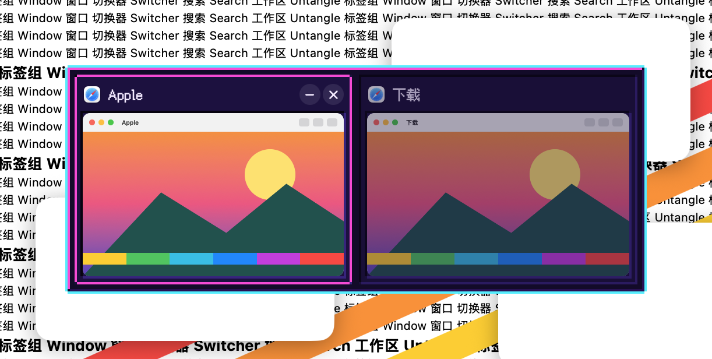
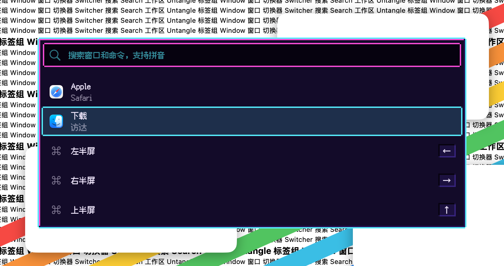
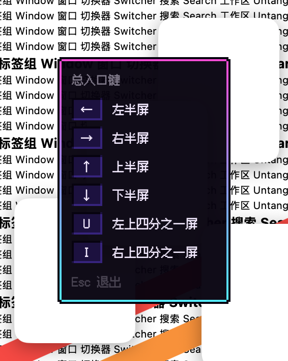
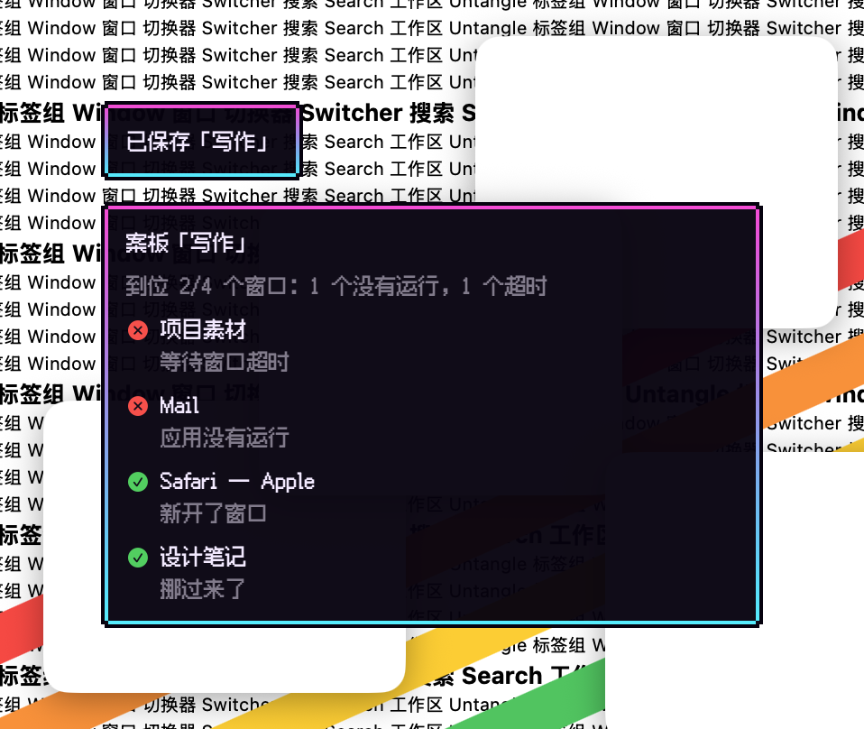

# 像素·霓虹 · 2026-10-23

**定位**：街机屏幕：深紫黑底，洋红亮边、青色外框，选中是青色光框。像素版的赛博朋克。

## 配色

| 项 | 值 |
|---|---|
| 面板 | `#140a2a`，亮边 `#ff3ad8`，暗边 `#2a0f55`，外框 `#29f0ff` |
| 文字 | `#f3e9ff` |
| 格子 | `#1d1040`，凹边 `#07030f` / `#3a2280` |
| 选中 | 青色 16% 亮色，边框 `#29f0ff` |
| 悬停边框 | `#ff3ad8` |
| 说明框 | 底 `#07020f`，边 `#ff3ad8` → `#29f0ff` |
| 搜索框 | 底 `#07020f`，字 `#29f0ff`，边 `#ff3ad8` |

## 像素系列共用的规则

- **网格**：2 点一格；所有边都按整数格画，全部直角，外框的四个角各缺一格。
- **立体感**：凸起的面（面板、当前标签）左上亮、右下暗；凹进去的格子（卡片、行、键帽、未选中的标签）反过来。
- **选中**：格子底下垫一层亮色，外面一圈选中色边框（强调色，可在工坊里改）；悬停是一格宽的悬停色边框。选中框在格子之间直接跳，不滑动。
- **字体**：内置 Fusion Pixel 12px（简体中文，SIL OFL 1.1），固定 12 点，中英文都是像素字；字体加载失败时退回系统字体。
- **缩略图**：窗口画面保持清晰、方角，只有它所在的格子是像素边框。
- **快捷键提示、提示浮窗**：做成说明框：深色纸条、一格自身色外框，内边一格从上到下渐变。
- **增强对比度**：选中边框加粗一格，非当前标签不淡化。
- **工坊里**：外形、切角、发光、动效、卡片外形、选中标记和字号这些选项对像素皮肤不适用，会自动隐藏。

## 代码

`Sources/OverlayKit/PixelSkin.swift`（调色板、立体边框、格子、说明框、字体注册与 `overlayFont`），模板在 `TabBarTheme.swift`，字体在 `Sources/CoreKit/Resources/Fonts/`。

## 皮肤包渲染

`package/` 是按 [皮肤包格式](../FORMAT.zh-CN.md) 写的皮肤包，打成 `.untangleskin` 后可在皮肤工坊导入。2026-10-23 起它不再照抄上面的内置版，改成霓虹地牢游戏界面的样子：深靛蓝网格底、圆角霓虹灯管做边（蓝色面板边、青色选中、洋红悬停）、选中时灯光闪一下亮起、白色键帽、说明卡停留变淡时整张变淡。做法见 [package/README.md](package/README.md)。

下图由 App 的皮肤包引擎读取 `package/` 画出：标签栏、切换器、搜索面板、快捷键提示；当前标签、第二张卡片和第二行处于选中状态。

## 截图（App）

