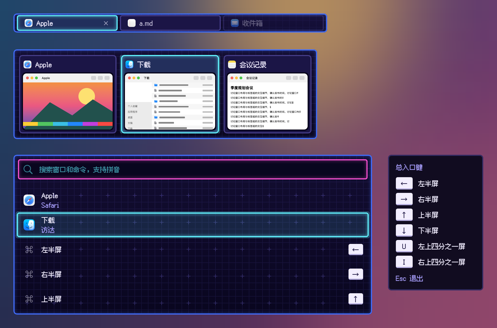

# 像素·霓虹 · 皮肤包

格式见 `../../FORMAT.zh-CN.md`。2.0.0 起这个包不再照抄内置的像素·霓虹，改画成霓虹地牢游戏界面的样子（2026-10-23 选定的方案 C「灯管」）：

- 面板：深靛蓝到近黑的渐变底，铺一层 12 点一格的淡网格，每 48 点一个淡「+」（`assets/plus.png`，1 像素 = 1 点，平铺）；边是 2 点粗的蓝色圆角霓虹灯管，灯管内侧有柔光。切换器、Dock 预览、搜索面板弹出时灯光闪一下亮起；标签栏常驻，不闪。
- 卡片、标签：深色圆角槽、暗紫细边。悬停换成洋红灯管加柔光；选中是青色灯管、淡青底、内侧柔光和外面一圈淡光晕。选中时灯光闪一下（0.24 秒，四步跳变：暗、亮、暗、亮），状态本身直接跳，不滑动。
- 搜索框：近黑底、洋红灯管边，输入文字青色；选中的搜索结果同卡片。
- 键帽：白色圆角键，下沿一道淡紫阴影，深色字；用填充加只描下边的描边（`"segments": "bottom"`）画，不用图片。
- 快捷键提示、提示浮窗：近黑的说明卡、暗紫细边；快捷键提示停留变淡时整张卡一起变淡（`"dimmed": "panel"`）。
- 缩略图：后面垫一块圆角深色屏，缩略图自己的形状不变（外形放在图层上，不放在 `well` 上）。
- 文字：标题近白，副标题淡紫；全部用像素字体 `fonts/FusionPixel-12px-Proportional-zh_hans.otf`，固定 12 点；授权见 `LICENSE-*.txt`（SIL OFL 1.1）。
- 增强对比度：去掉网格、柔光、光晕和闪烁，选中边加粗成两道。系统开启“减少动态效果”时不闪，直接亮。
- 工坊可调：选中框、悬停框、面板边的颜色。

素材和 `skin.json` 由 `../../make-pixel-packages.py` 生成。

按本包画出的样子：

打包：在本目录执行 `zip -q -r -X ../像素霓虹.untangleskin . -x '.*'`。
