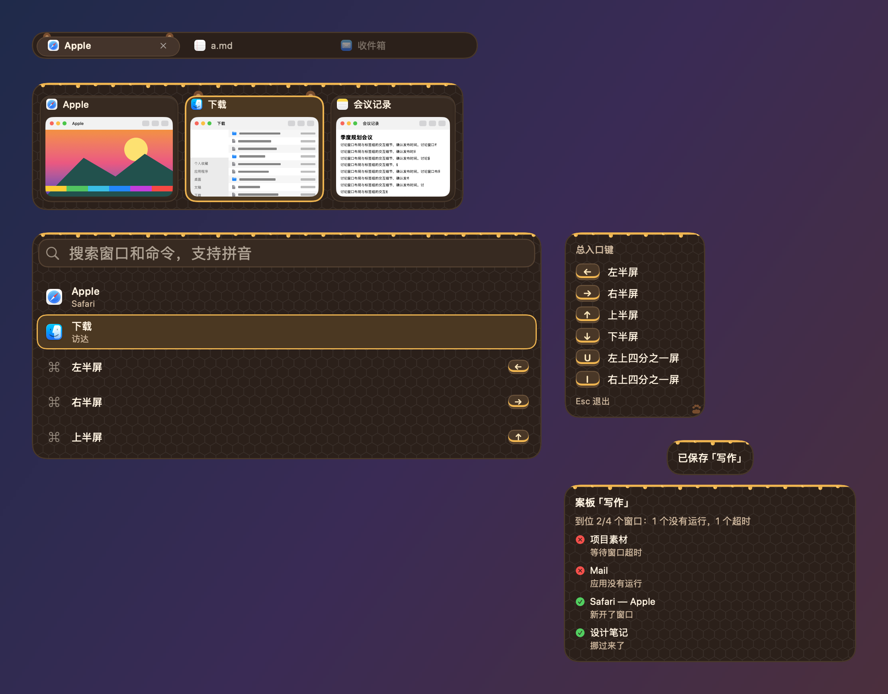
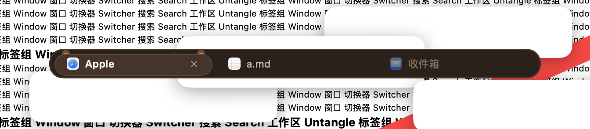
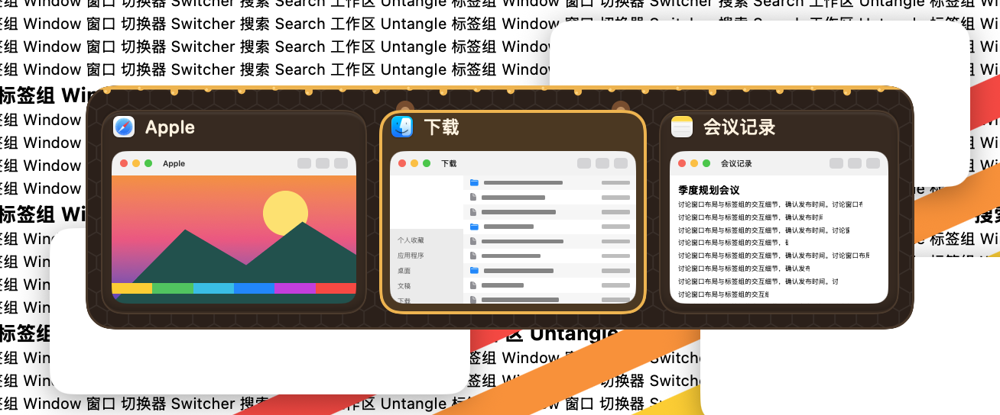
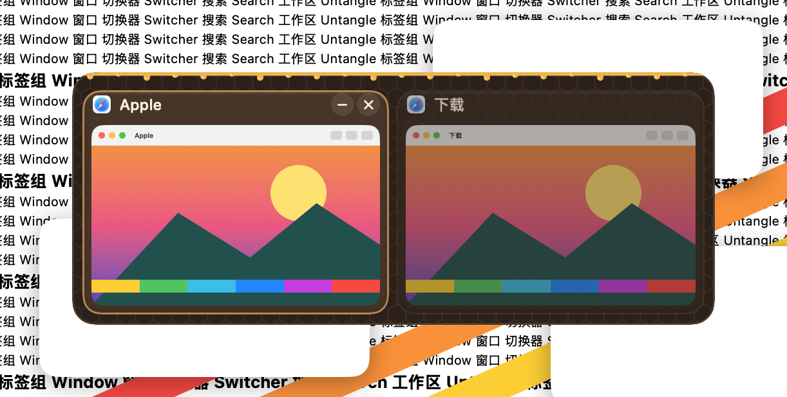
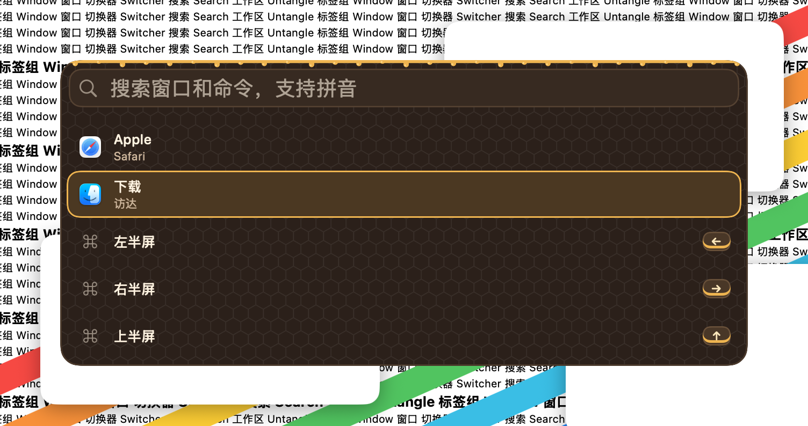
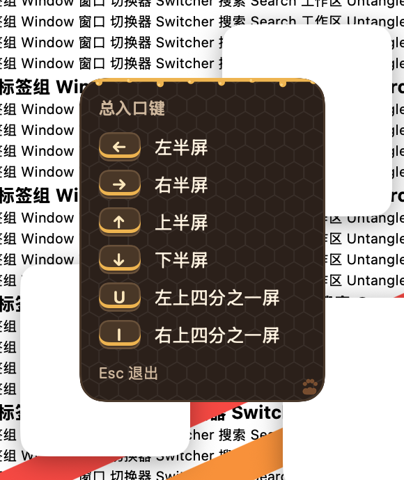
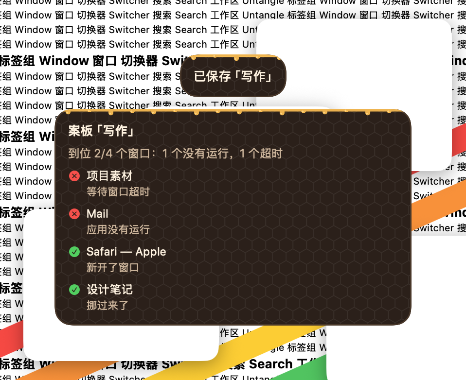

# 可可熊 · 2026-10-23

**定位**：蜂蜜小熊的深色版：热可可色的面板、奶油色的字，蜂蜜照样淌在面板上沿。只用通用的动物特征，不画、不借用任何现成角色。设计和取舍见 [可爱风格调研](../调研-可爱风格-2026-10-23.md)。

## 配色

| 项 | 值 |
|---|---|
| 面板 / 描边 | `#2C2019` / `#4A3729` |
| 文字 / 次要文字 | `#FFF2DF` / `#CFB59A` |
| 卡片 / 缩略图底 | `#382A20` / `#30241B` |
| 选中描边 / 选中底色 | `#F2B243` / `#4C3720` |
| 悬停 | `#B6844F` |
| 标签栏 / 当前标签 | `#2C2019` / `#45332A` |
| 键帽 / 键帽字 | `#4A3626` / `#FFE7B8` |
| 搜索框 / 描边 | `#382A20` / `#574131` |
| 装饰 | 熊耳 `#7A4B2B`，内耳 `#C28E5F`，蜂蜜 `#F2B243` |

## 各元素

- 面板：圆角 18，热可可色底，极淡的蜂巢格；上沿照样淌着一圈蜂蜜。
- 卡片：可可色；选中时深蜜色底、2 点蜂蜜边，冒出一对棕色圆耳。
- 悬停：焦糖色细边加淡底。
- 标签：当前标签浅一层的可可色胶囊，两只小圆耳。
- 搜索结果：选中行是深蜜色胶囊加蜂蜜边。
- 键帽：深可可色，奶油色字，底边一道蜂蜜色。
- 快捷键提示：右下角一枚熊掌印。
- 熊耳是 `box` 色块，工坊里能改颜色。
- 字体：系统圆体（英文和数字是圆体，中文是苹方），字号和粗细由各模块决定。
- 动效：选中框弹簧滑动（0.34 秒，带一点回弹），耳朵和角标从卡片后面弹上来；悬停原地淡入（0.12 秒）。开启“减少动态效果”时一律直接切换。
- 增强对比度：描边加粗，去掉底纹，耳朵保留。
- 装饰都画在文字和缩略图下面；面板本身不往外画，面板上的装饰只放在留白里。

## 皮肤包

`package/` 是按 [皮肤包格式](../FORMAT.zh-CN.md) 写的皮肤包，由 `make-cute-packages.py`（本地素材生成工具） 生成，打成 `.untangleskin` 后可在皮肤工坊导入。下图由 App 的皮肤包引擎读取 `package/` 画出，不是网页模拟：标签栏、切换器、搜索面板、快捷键提示和提示浮窗；当前标签、第二张卡片和第二行处于选中状态。

## 截图（App，繁杂背景）

