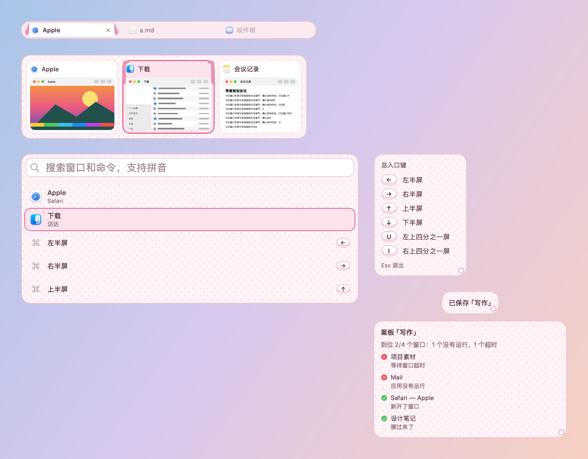

# 垂耳兔 · 皮肤包

> 已停用（2026-10-23）：垂耳在卡片 7 点的留白里放不下，看不出是兔子，由 [草莓兔](../../草莓兔-2026-10-23/) 替换（同一个包 id，版本 1.1.0）。生成脚本里已去掉这一版的代码，原样见提交 48ab3df。

格式见 `../../FORMAT.zh-CN.md`，设计见 `../../调研-可爱风格-2026-10-23.md`。草莓牛奶粉、奶白和浅紫：选中卡片两侧垂下一对软耳朵，面板上是很淡的圆点。

- `assets/ears.png`：选中卡片的一对垂耳（九宫格左上、右上两角，各 15 × 48 点，画在选中底色之上、内容之下）：耳根沿卡片上沿的留白搭过角，再顺着左右 7 点的留白垂下来，不碰标题和缩略图；`assets/tab-ears.png`：当前标签两端的小垂耳；`assets/dots.png`：面板的圆点底纹（平铺）；`assets/sticker.png`：右下角的绒球尾巴。
- 增强对比度时去掉圆点底纹。
- 所有素材由 `skins/make-cute-packages.py` 用 Pillow 画出：2 像素 = 1 点（`"scale": 0.5`），全部原创，CC0。
- 装饰都画在文字和缩略图下面；面板本身不往外画，面板上的装饰只放在留白里。
- 字体：系统圆体（`"design": "rounded"`），字号和粗细由各模块决定。
- 动效：选中框弹簧滑动（0.34 秒，带一点回弹），耳朵和角标从卡片后面弹上来（`pop`）；悬停原地淡入。开启“减少动态效果”时一律直接切换。
- 增强对比度：描边加粗；耳朵保留。
- 工坊可调：选中色、悬停色。图片里的耳朵颜色固定。

按本包画出的样子：

打包：在本目录执行 `zip -q -r -X ../垂耳兔.untangleskin . -x '.*'`。
