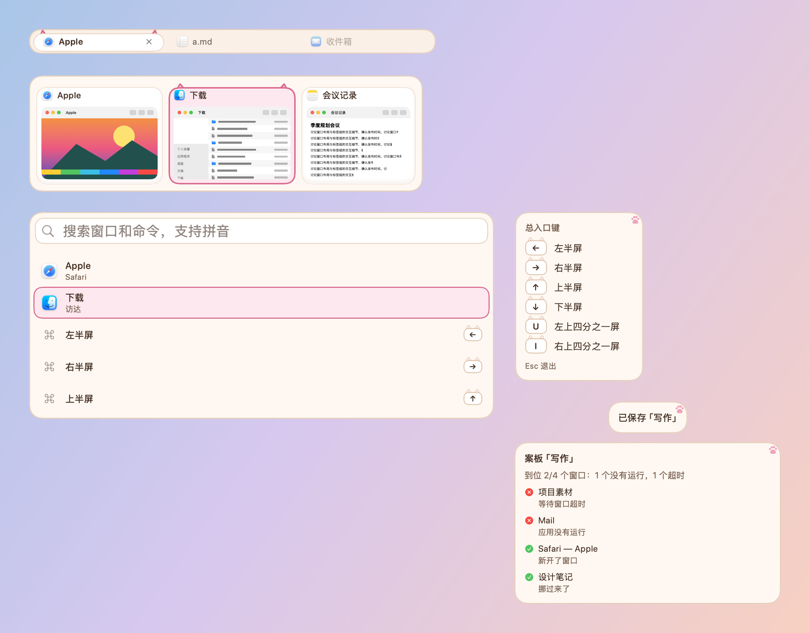
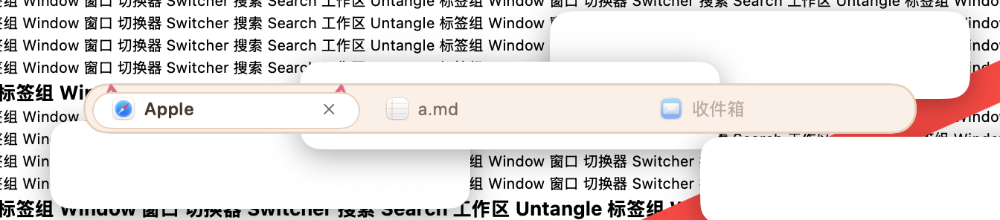
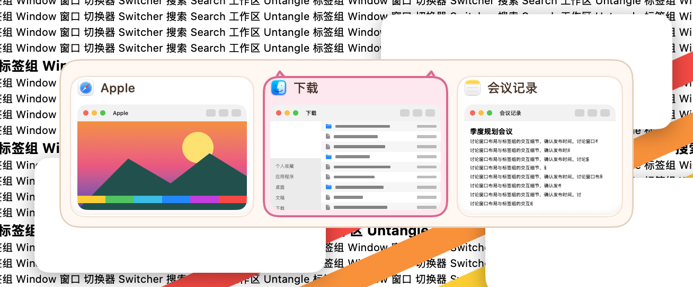
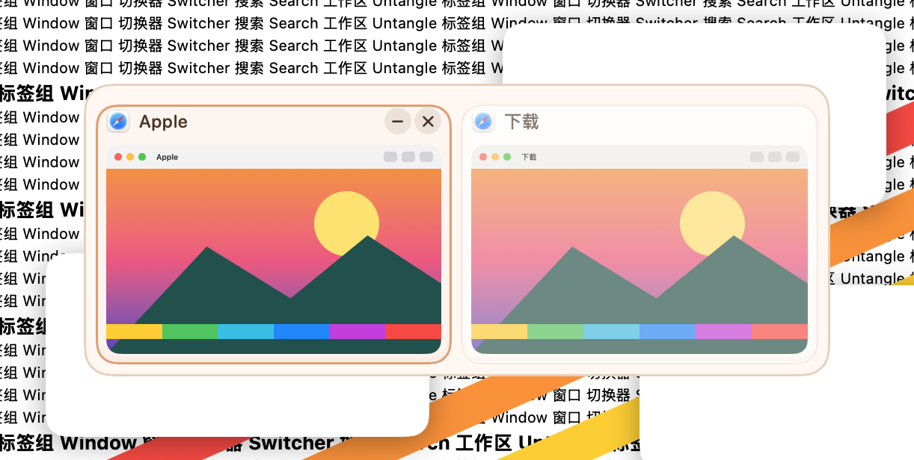
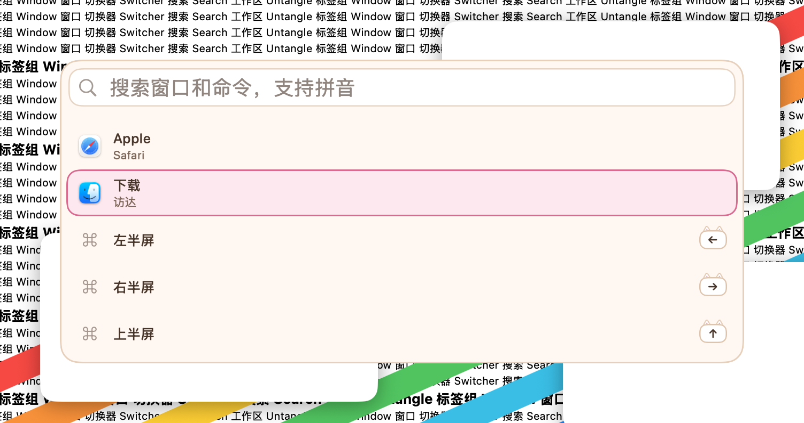
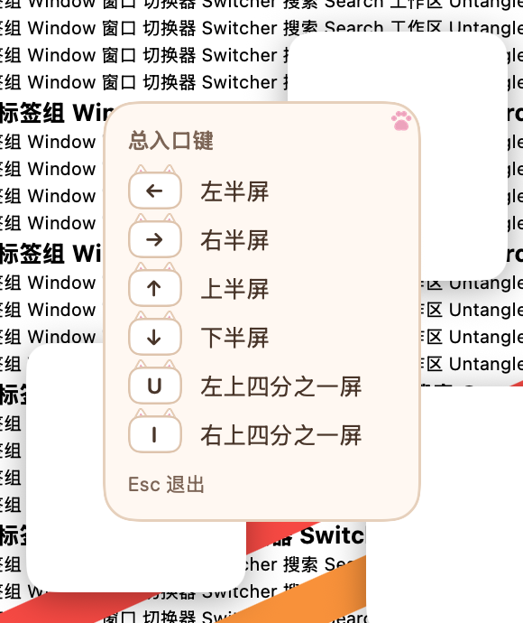
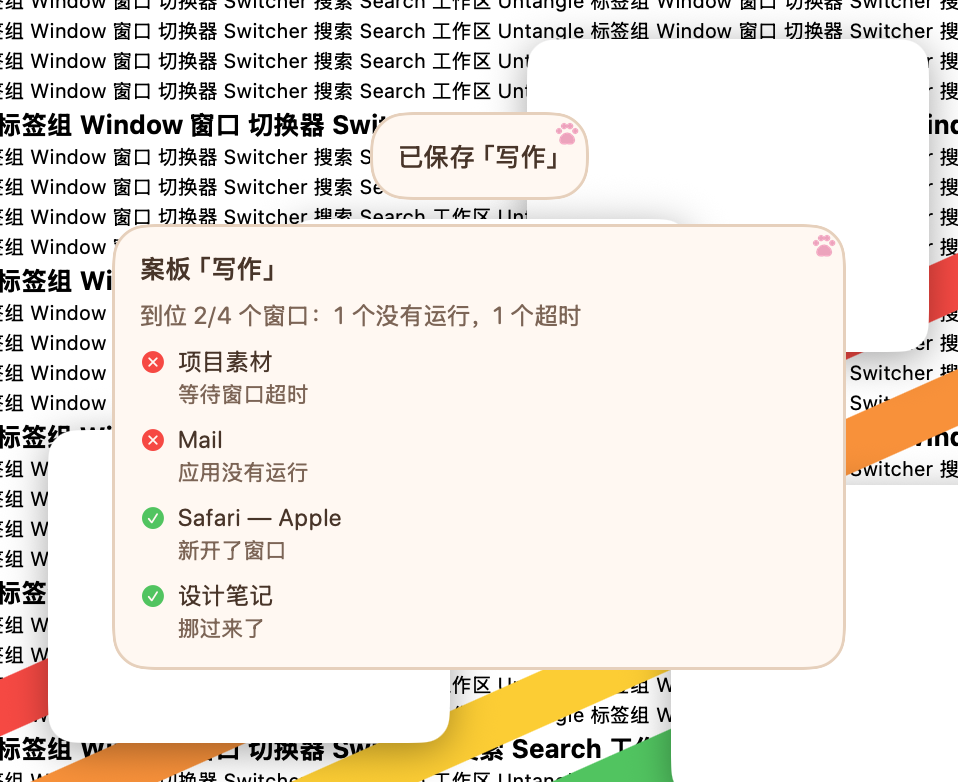

# 奶油猫 · 2026-10-23

**定位**：奶茶色的底、粉色肉垫：选中的卡片和当前标签探出一对猫耳，键帽像一排小猫头。只用通用的动物特征，不画、不借用任何现成角色。设计和取舍见 [可爱风格调研](../调研-可爱风格-2026-10-23.md)。

## 配色

| 项 | 值 |
|---|---|
| 面板 / 描边 | `#FFF8F1` / `#E8CFBA` |
| 文字 / 次要文字 | `#4A3428` / `#7E6455` |
| 卡片 / 缩略图底 | `#FFFFFF` / `#F6ECE2` |
| 选中描边 / 选中底色 | `#E0648F` / `#FFE7EF` |
| 悬停 | `#E59A6C` |
| 标签栏 / 当前标签 | `#FBF0E6` / `#FFFFFF` |
| 键帽 / 键帽字 | `#FFFFFF` / `#4A3428` |
| 搜索框 / 描边 | `#FFFFFF` / `#E9D3C1` |
| 装饰 | 肉垫 `#F2A0BC`，耳内 `#FFD3E1` |

## 各元素

- 面板：圆角 18，奶油底，1.5 点奶茶色描边。
- 卡片：白色软垫，内阴影上亮下暗；底色和描边从上沿让出 6 点，留给耳朵。
- 选中：粉色底、2 点粉边，一对粉色猫耳立在卡片上沿的留白里，选中时从底色后面弹上来。
- 悬停：蜜桃色 1.5 点细边加一层淡底，原地淡入。
- 标签：当前标签是白色胶囊，两只小猫耳伸出 3 点；悬停淡底；拖入时粉色虚线。
- 搜索结果：选中行是粉色胶囊底加粉边。
- 键帽：白色圆角键帽，奶茶色描边，两只三角耳伸出 3 点，像一排小猫头。
- 快捷键提示、提示浮窗：右上角留白里一枚粉色肉垫。
- 字体：系统圆体（英文和数字是圆体，中文是苹方），字号和粗细由各模块决定。
- 动效：选中框弹簧滑动（0.34 秒，带一点回弹），耳朵和角标从卡片后面弹上来；悬停原地淡入（0.12 秒）。开启“减少动态效果”时一律直接切换。
- 增强对比度：描边加粗，耳朵保留。
- 装饰都画在文字和缩略图下面；面板本身不往外画，面板上的装饰只放在留白里。

## 皮肤包

`package/` 是按 [皮肤包格式](../FORMAT.zh-CN.md) 写的皮肤包，由 `make-cute-packages.py`（本地素材生成工具） 生成，打成 `.untangleskin` 后可在皮肤工坊导入。下图由 App 的皮肤包引擎读取 `package/` 画出，不是网页模拟：标签栏、切换器、搜索面板、快捷键提示和提示浮窗；当前标签、第二张卡片和第二行处于选中状态。

## 截图（App，繁杂背景）

