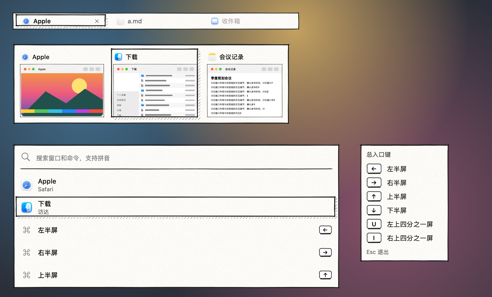

# 手绘·钢笔 · 2026-10-23

**定位**：白纸上的钢笔速写。线条略有抖动，四角两笔交叉出头，选中处多一条斜线排线的阴影。只有黑白两色，文字始终是深墨色，在繁杂的桌面上也清楚。

只做成皮肤包（`package/`），没有内置版本，装上就能用，不用更新 App。设计过程和另外两个候选见 [调研](../调研-黑白手绘-2026-10-23.md)。

## 配色

| 项 | 值 |
|---|---|
| 纸 | `#fdfcf9`，纸纹最深约 5% |
| 墨线、文字 | `#151515` |
| 次要文字 | `#5a5a5a`（纸上对比度 6.7:1） |
| 悬停的铅笔线 | `#666666` |
| 排线 | 墨色，50% |

## 绘制

- **面板、标签栏**：纸只铺在墨线框里面，框外只露出交叉出头的笔画；墨线描两遍，第二遍更细、略错开。
- **选中**：墨线框，右边和下边多一条斜线排线的阴影。卡片、搜索结果、当前标签都一样。
- **悬停**：铅笔灰的单线框。
- **拖入的标签**：铅笔灰虚线框；拖动标签时的提示环是墨色虚线。
- **键帽**：白底墨线小键，底边加粗。
- **缩略图**：外面一圈细墨线，像贴在纸上的速写。
- **搜索框**：下面一道墨水线。
- **卡片按钮**：手绘的圆圈，悬停时垫一层浅墨色。
- **动效**：选中框滑到新位置（0.18 秒），悬停原地淡入（0.1 秒）。系统开了“减少动态效果”时直接切换。
- **增强对比度**：去掉纸纹和排线，换成 2 点实线框和实心灰阴影。
- **工坊里**：可调纸纹和排线浓淡。

## 皮肤包渲染

下图由 App 的皮肤包引擎读取 `package/` 画出，不是示意图：标签栏、切换器、搜索面板、快捷键提示；当前标签、第二张卡片和第二行处于选中状态。

## 各模块

同一张繁杂桌面背景，App 引擎渲染。Dock 预览里鼠标停在第一张卡片上。

## 生成与打包

- 素材和 `skin.json`：`python3 skins/make-hand-drawn-packages.py`（需要 Pillow 和 NumPy）。随机种子固定，每次生成的文件都一样。
- README、卡片和效果图不由脚本生成：效果图来自画廊 `SkinPackageGallery`，卡片和上面的渲染图来自同一套面板摆在一起的一次渲染。
- 打包：在 `package/` 里执行 `zip -q -r -X ../手绘钢笔.untangleskin . -x '.*'`，双击或在皮肤工坊里导入。
