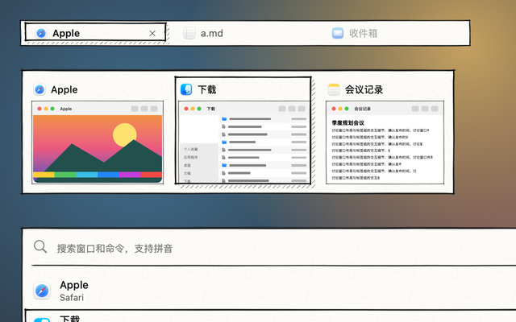
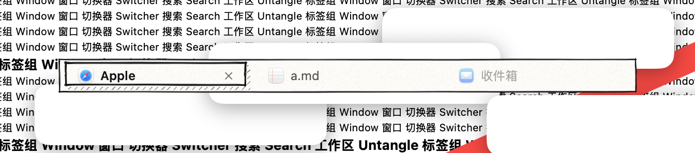
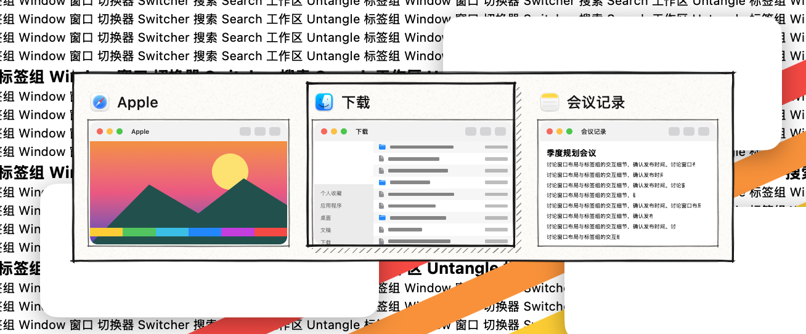
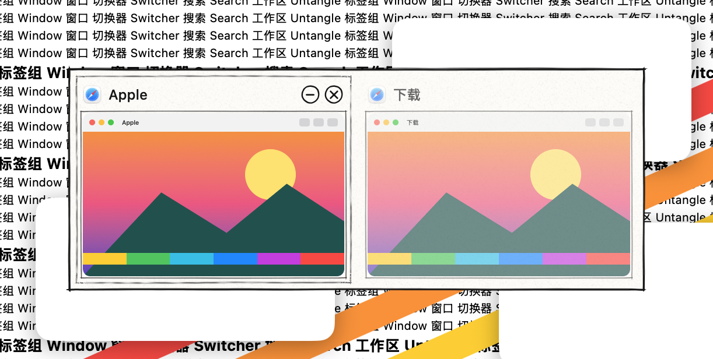
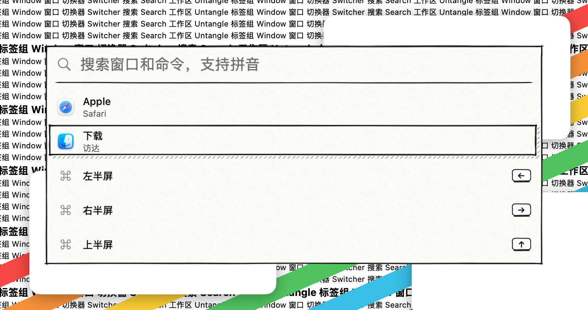
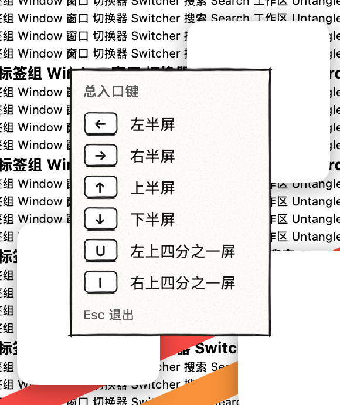
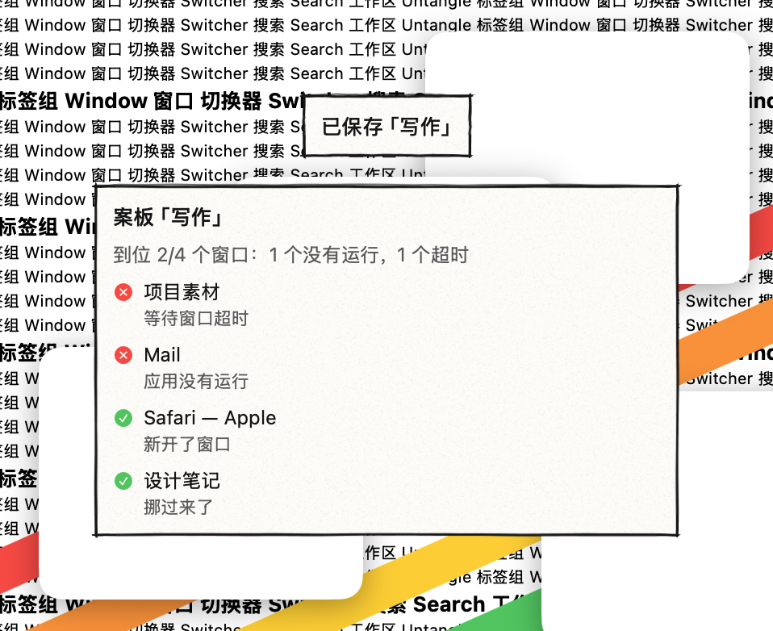

# 手绘·钢笔 · 皮肤包

格式见 `../../FORMAT.zh-CN.md`。所有图片都由 `skins/make-hand-drawn-packages.py` 生成，是原创素材（CC0）：2 像素对 1 点（`"scale": 0.5`），8 倍超采样后缩小，平滑缩放（`"filter": "smooth"`）。

- `assets/panel.png`（256×160，九宫格四角 16 点）：面板。纸只铺在墨线框里面，框外只露出交叉出头的笔画。墨线描两遍：1.5 点一遍，0.8 点再一遍并略微错开。抖动和交叉的角都在大小不变的四角里，四条边的中段只有很缓的弯曲和粗细变化，所以拉到任何大小都像一笔画成。
- `assets/bar.png`（200×64，四角 10 点）：标签栏，同样画法，只描一遍。标签栏只比标签高几点，所以框贴着边画，免得和当前标签的框挤在一起。
- `assets/box.png`（96×96，四角 10 点）：选中框，墨线描两遍。
- `assets/pencil.png`（96×96，四角 10 点）：悬停框，铅笔灰（`#666666`）单线，带石墨颗粒。
- `assets/hatch.png`（96×96，平铺）：45° 斜线排线。每条线的抖动按贴图边长周期变化，拼接处不断线。
- `assets/grain.png`（256×256，平铺）：纸纹，细斑点和几根纤维，最深约 5%。
- `assets/key.png`（48×40，四角 7 点）：键帽，白底墨线，底边加粗。
- `assets/circle.png`（36×36，拉伸）：卡片上关闭、最小化按钮的手绘圆圈。
- `assets/rule.png`（176×24，九宫格 上 2、右 12、下 8、左 12 点）：搜索框下面的墨水线，左右各缩进 12 点。
- `assets/well.png`（80×80，四角 8 点）：缩略图外的一圈细墨线。图层向外 3 点、不裁剪（`"inset": -3`、`"clip": false`），所以线画在缩略图外面。

**选中**（卡片、搜索结果、当前标签）：墨线框，右边和下边多一条斜线排线的阴影（卡片 4 点宽，其余 3 点）。格式没法直接画“右、下两条定宽的条带”，所以分几层拼：先铺排线（上、左各缩进阴影宽度加 1 点），再用一层和纸同色的填充盖住除阴影以外的部分（右、下各缩进阴影宽度），最后铺纸纹、画框。

**悬停**：铅笔灰单线框（标签、卡片）。卡片按钮悬停时圆圈里垫一层 14% 的墨色。

**拖入的标签**：铅笔灰虚线框。拖动标签时标签栏外的提示环：墨色虚线。

**文字**：标题、正文、键帽和搜索文字 `#151515`，次要文字 `#5a5a5a`。选中时文字颜色不变。

**动效**：选中框 0.18 秒平滑地滑到新位置，排线阴影跟着走；悬停 0.1 秒原地淡入。

**增强对比度**：面板、标签栏换成纸色底加 2 点实线框；选中换成 2 点实线框加实心灰阴影；不要纸纹和排线。

**工坊可调**：纸纹（0–1）、排线浓淡（0–1）。墨线画在图片里，颜色不能改。

App 引擎画出的样子：

打包：在本目录执行 `zip -q -r -X ../手绘钢笔.untangleskin . -x '.*'`。
