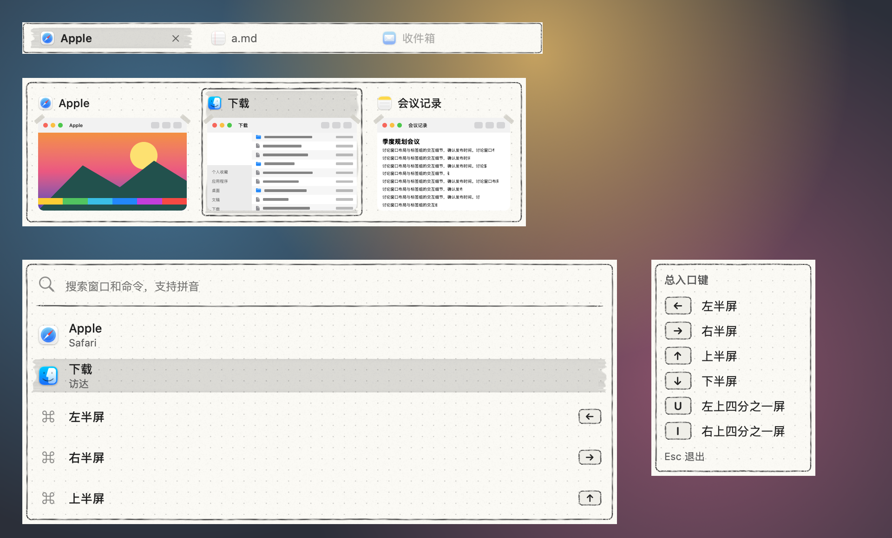

# 手绘·铅笔 · 2026-10-23

**定位**：点阵笔记本上的铅笔稿。石墨线有颗粒感，选中处像用灰色荧光笔划过，缩略图用纸胶带贴着。比钢笔版安静，线条更软。

只做成皮肤包（`package/`），没有内置版本，装上就能用，不用更新 App。设计过程和另外两个候选见 [调研](../调研-黑白手绘-2026-10-23.md)。

## 配色

| 项 | 值 |
|---|---|
| 纸 | `#fbfaf5`，很淡的纸纹 |
| 点阵 | `#0000002b`，间距 12 点 |
| 铅笔线 | `#363636`；悬停的浅铅笔线 `#777777` |
| 文字 | `#232323` |
| 次要文字 | `#5c5c5c`（纸上 6.4:1，荧光笔上 4.8:1） |
| 荧光笔 | 黑色 13% |

## 绘制

- **面板**：米白纸加点阵，离边 5 点有一圈铅笔一笔画的圆角框，收笔处略出头。标签栏是同样的纸和更细的框，不画点阵。
- **选中**：灰色荧光笔涂层；切换器和 Dock 预览里的卡片再加一圈石墨框。
- **悬停**：浅铅笔框。
- **拖入的标签**：浅铅笔虚线框；拖动标签时的提示环是石墨色虚线。
- **键帽**：浅灰底铅笔小键。
- **缩略图**：上面两个角贴着纸胶带。
- **搜索框**：下面一道铅笔线。
- **卡片按钮**：铅笔圆圈，悬停时垫一层浅灰。
- **动效**：选中和悬停都原地淡入（0.14 秒），不滑动。系统开了“减少动态效果”时直接切换。
- **增强对比度**：去掉点阵和纸纹，框换成 2 点石墨实线，选中处再加一圈实线。
- **工坊里**：可调纸色、点阵颜色和纸纹。

## 皮肤包渲染

下图由 App 的皮肤包引擎读取 `package/` 画出，不是示意图：标签栏、切换器、搜索面板、快捷键提示；当前标签、第二张卡片和第二行处于选中状态。

## 各模块

同一张繁杂桌面背景，App 引擎渲染。Dock 预览里鼠标停在第一张卡片上。

## 生成与打包

- 素材和 `skin.json`：`python3 skins/make-hand-drawn-packages.py`（需要 Pillow 和 NumPy）。随机种子固定，每次生成的文件都一样。
- README、卡片和效果图不由脚本生成：效果图来自画廊 `SkinPackageGallery`，卡片和上面的渲染图来自同一套面板摆在一起的一次渲染。
- 打包：在 `package/` 里执行 `zip -q -r -X ../手绘铅笔.untangleskin . -x '.*'`，双击或在皮肤工坊里导入。
