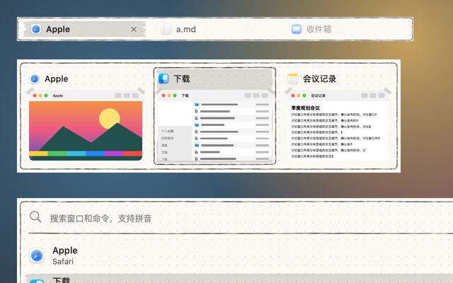
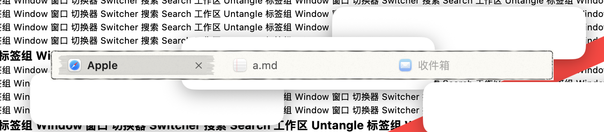
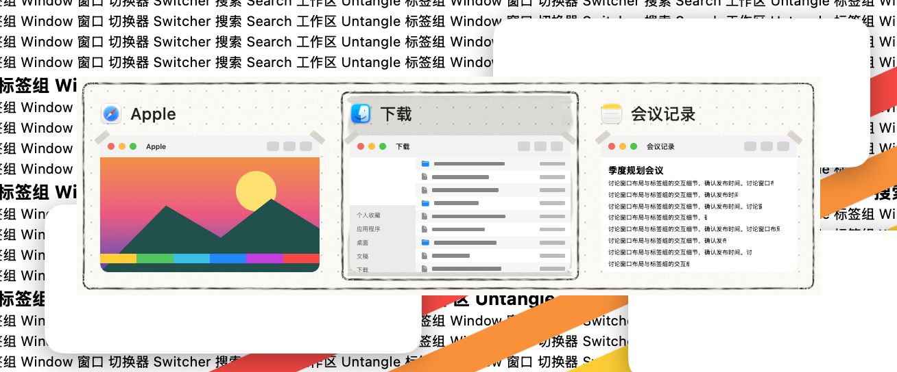
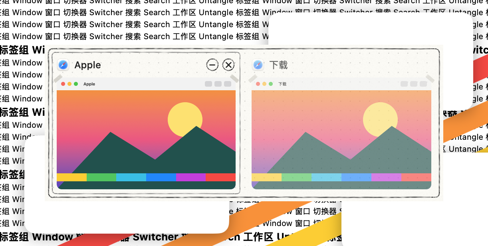
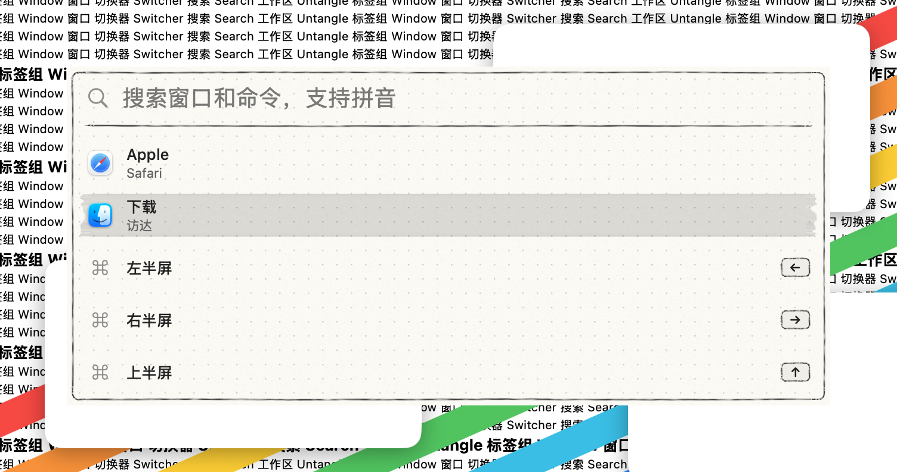
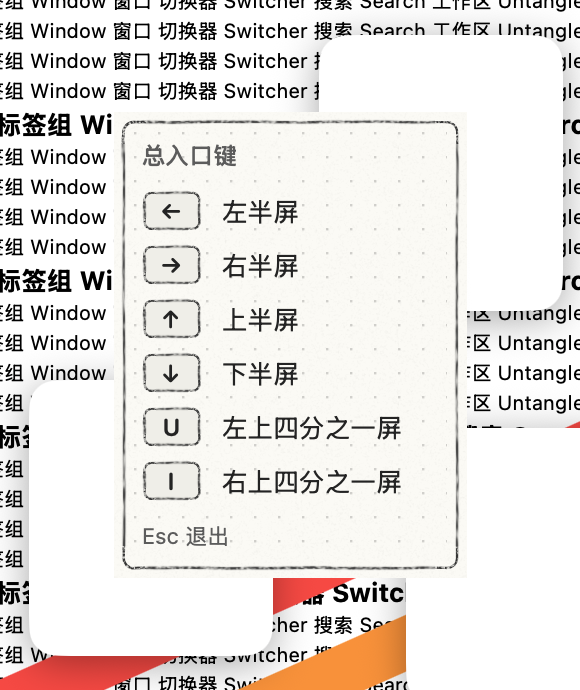
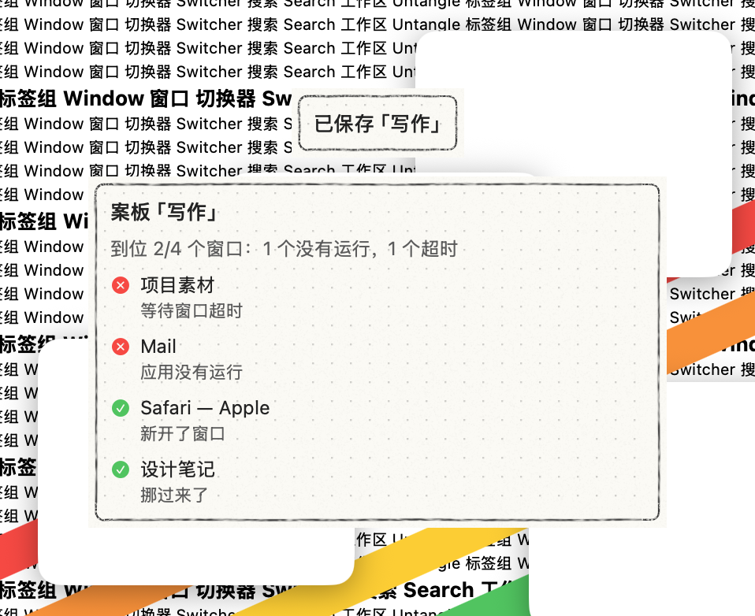

# 手绘·铅笔 · 皮肤包

格式见 `../../FORMAT.zh-CN.md`。所有图片都由 `skins/make-hand-drawn-packages.py` 生成，是原创素材（CC0）：2 像素对 1 点（`"scale": 0.5`），8 倍超采样后缩小，平滑缩放（`"filter": "smooth"`）。

- 纸：`fill` 图层，颜色 `#fbfaf5`，可在工坊里改；上面铺一层很淡的纸纹 `assets/grain.png`（256×256，平铺）。
- 点阵：程序纹理（`"kind": "dots"`），间距 12 点、1.2 点见方，颜色 `#0000002b`；离面板边 10 点以内不画，标签栏上不画。
- `assets/frame.png`（256×160，九宫格四角 16 点）：面板的铅笔框，离边 5 点、圆角 5 点。一笔画成：从左上角下面起笔，绕一圈后多画 5 点，收笔处略向外偏。石墨线有颗粒感。
- `assets/barframe.png`（200×64，四角 10 点）：标签栏的细铅笔框，贴着边画，给标签留出位置。
- `assets/box.png`（96×96，四角 10 点）：选中卡片外的石墨框（`#363636`，1.3 点）。
- `assets/pencil.png`（96×96，四角 10 点）：悬停的浅铅笔框（`#777777`）。
- `assets/marker.png`（128×56，九宫格 上 8、右 12、下 8、左 12 点）：灰色荧光笔。中间是平涂的 13% 黑，上下边略深，两端是毛糙的起笔和收笔；中间平涂，所以能拉到任何大小。
- `assets/tape.png`（80×80，四角 14 点）：缩略图上面两个角的纸胶带。画在缩略图上方（`"over": true`），向外 4 点、不裁剪，所以胶带能伸出缩略图的角。
- `assets/key.png`（48×40，四角 7 点）：键帽，浅灰底铅笔线。
- `assets/circle.png`（36×36，拉伸）：卡片上关闭、最小化按钮的铅笔圆圈。
- `assets/rule.png`（176×24，九宫格 上 2、右 12、下 8、左 12 点）：搜索框下面的铅笔线。

**选中**：卡片是荧光笔涂层（缩进 2 点）加一圈石墨框；搜索结果和当前标签只有荧光笔涂层。

**悬停**：浅铅笔框（标签、卡片）。卡片按钮悬停时圆圈里垫一层 12% 的黑。

**拖入的标签**：浅铅笔虚线框。拖动标签时标签栏外的提示环：石墨色虚线。

**文字**：标题、正文、键帽和搜索文字 `#232323`，次要文字 `#5c5c5c`。次要文字的颜色按荧光笔底色定，在涂层上也有 4.8:1。

**动效**：选中和悬停都原地淡入，0.14 秒，不滑动。

**增强对比度**：面板、标签栏换成纸色底加 2 点石墨实线框，不要点阵和纸纹；选中的卡片、搜索结果和当前标签再加一圈 2 点石墨实线。

**工坊可调**：纸色、点阵颜色、纸纹（0–1）。铅笔线、荧光笔和胶带画在图片里，颜色不能改。

App 引擎画出的样子：

打包：在本目录执行 `zip -q -r -X ../手绘铅笔.untangleskin . -x '.*'`。
