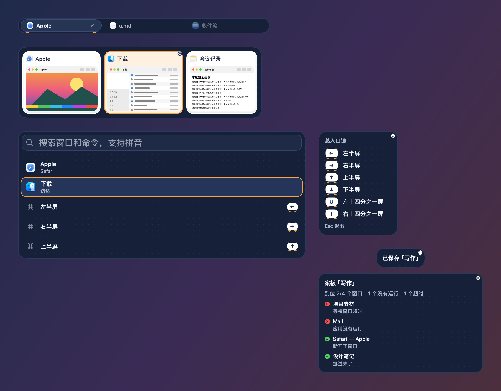
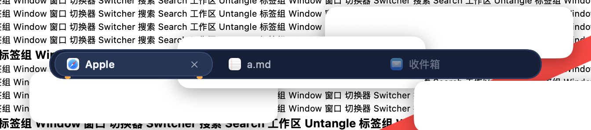
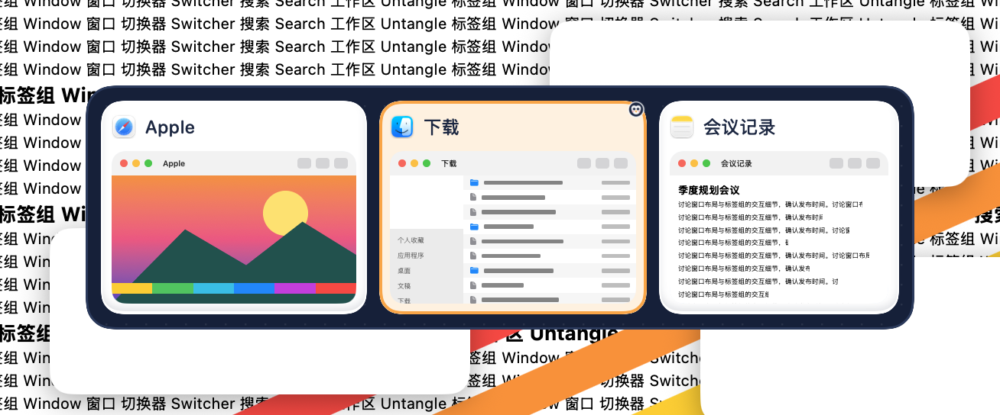
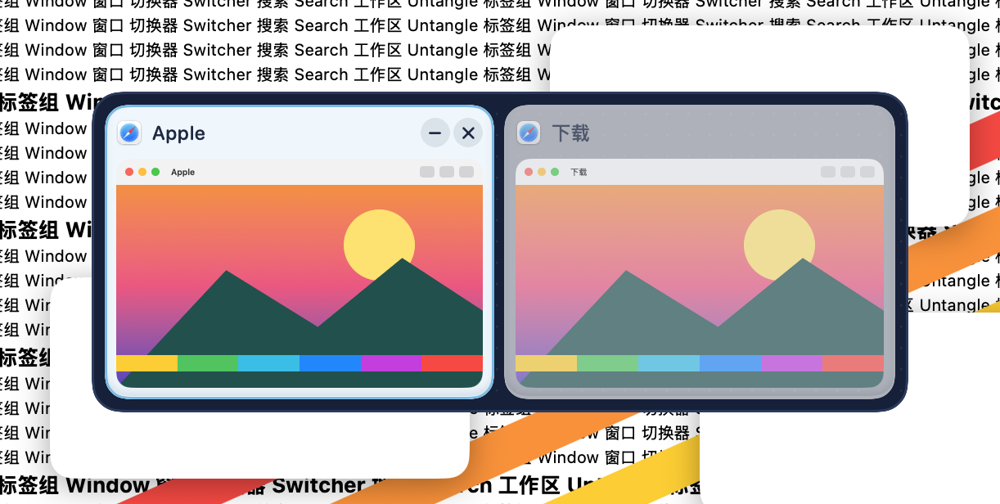
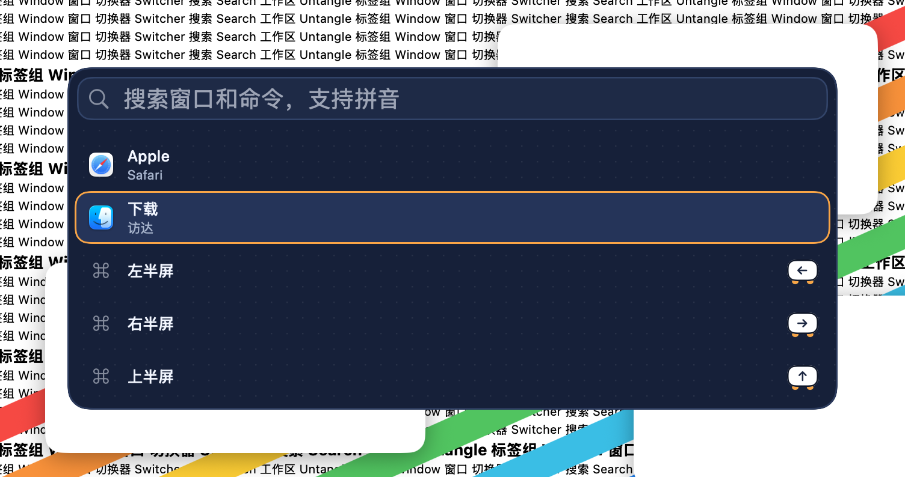
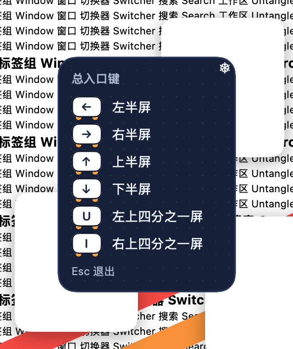
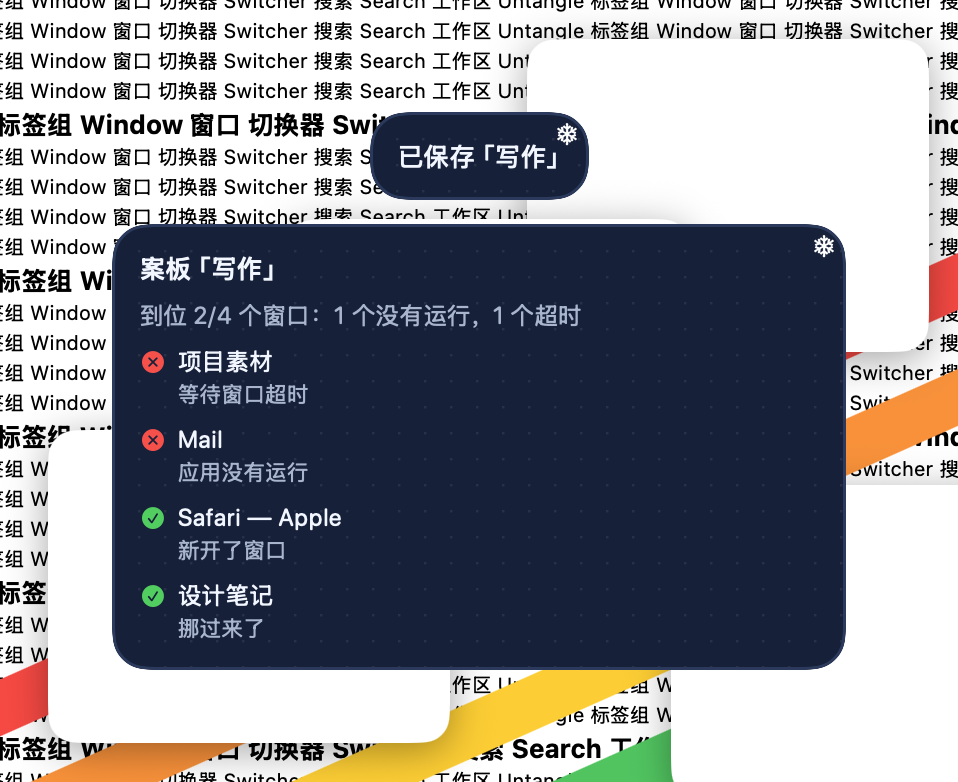

# 极夜企鹅 · 2026-10-23

**定位**：冰川企鹅的深色版：面板是企鹅深蓝的背，卡片是白肚皮，飘着很淡的雪点。只用通用的动物特征，不画、不借用任何现成角色。设计和取舍见 [可爱风格调研](../调研-可爱风格-2026-10-23.md)。

## 配色

| 项 | 值 |
|---|---|
| 面板 / 描边 | `#15203A` / `#2A3A5D` |
| 文字 / 次要文字 | `#F2F6FF` / `#A7B5CE` |
| 卡片 / 缩略图底 | `#FFFFFF` / `#E6EFF8` |
| 选中描边 / 选中底色 | `#FFA238` / `#FFF1DF` |
| 悬停 | `#72BBE8` |
| 标签栏 / 当前标签 | `#15203A` / `#263556` |
| 键帽 / 键帽字 | `#FFFFFF` / `#1C2843` |
| 搜索框 / 描边 | `#1D2A47` / `#31446B` |
| 装饰 | 企鹅 `#1C2843`，嘴和脚 `#FFA238`，雪花 `#FFFFFF` |

## 各元素

- 面板：圆角 18，企鹅背的深蓝，飘着很淡的雪点（程序纹理 `dots`）。
- 卡片：白肚皮，卡片里的字换成深蓝（元素内文字换色）；选中时橙色描边，右上角蹲着小企鹅。
- 悬停：冰蓝细边加淡底。
- 标签：当前标签是浅一层的深蓝胶囊，字是白色，底下露出两只橙色小脚。标签上的 × 用系统文字色，所以当前标签不做成白色。
- 搜索结果：选中行是浅一层的深蓝胶囊加橙边，字保持白色。
- 键帽：白肚皮、深蓝字，底下露出两只橙色小脚。
- 快捷键提示、提示浮窗：右上角一片白雪花。
- 字体：系统圆体（英文和数字是圆体，中文是苹方），字号和粗细由各模块决定。
- 动效：选中框弹簧滑动（0.34 秒，带一点回弹），耳朵和角标从卡片后面弹上来；悬停原地淡入（0.12 秒）。开启“减少动态效果”时一律直接切换。
- 增强对比度：描边加粗，去掉底纹，耳朵保留。
- 装饰都画在文字和缩略图下面；面板本身不往外画，面板上的装饰只放在留白里。

## 皮肤包

`package/` 是按 [皮肤包格式](../FORMAT.zh-CN.md) 写的皮肤包，由 `make-cute-packages.py`（本地素材生成工具） 生成，打成 `.untangleskin` 后可在皮肤工坊导入。下图由 App 的皮肤包引擎读取 `package/` 画出，不是网页模拟：标签栏、切换器、搜索面板、快捷键提示和提示浮窗；当前标签、第二张卡片和第二行处于选中状态。

## 截图（App，繁杂背景）

