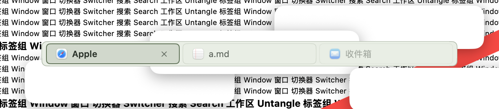
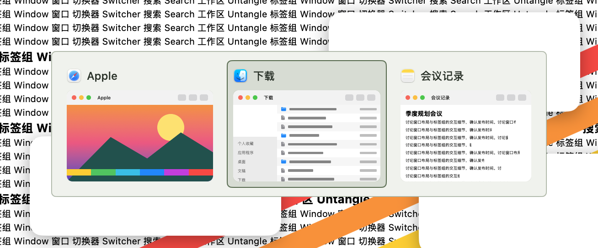
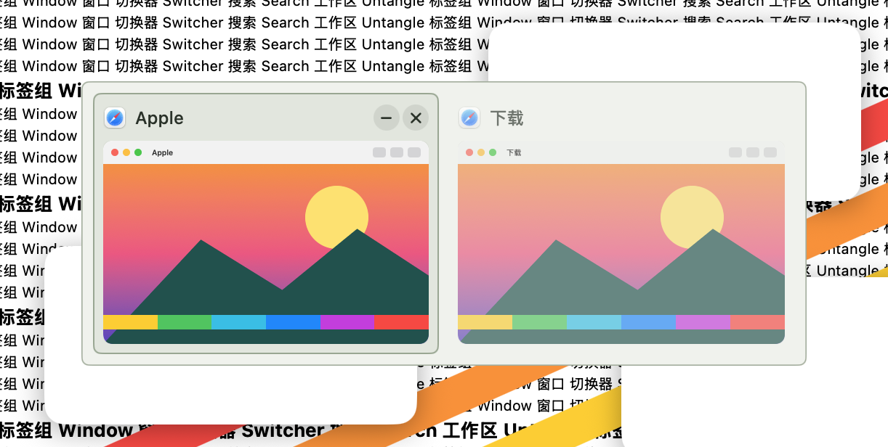
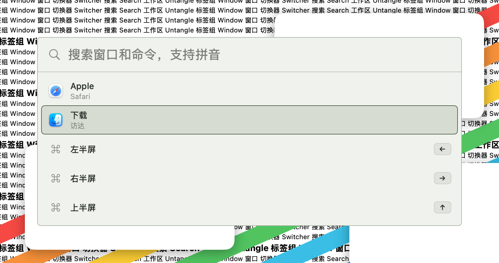
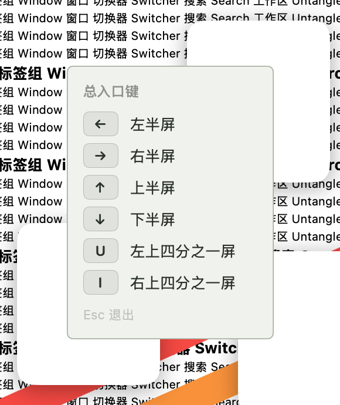
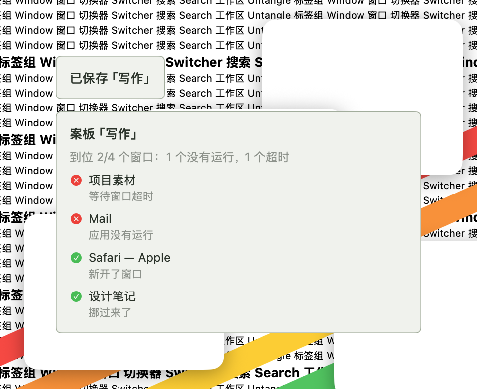

# 极简 · 2026-10-22

**定位**：像纸面一样安静。不透明的浅色底、深色字、细描边，不发光、不动。

## 参数

| 项 | 值 |
|---|---|
| 外形 | 圆角，半径 5 |
| 强调色（选中） | `#52684a` 墨绿 |
| 悬停色 | `#788c70` 灰绿 |
| 底色 | 标签栏 `#e9eee5`，面板 `#f0f2ed` |
| 文字 | `#293229` |
| 发光 | 0 |
| 背景不透明度 | 100% |
| 高亮动效 | 无 |
| 选中标记 | 无 |

## 绘制

- **配色固定为浅色**：不随系统深色模式变化，面板内的系统控件也按浅色绘制。
- **面板**：不透明底色 + 系统超薄材质 + 强调色细描边。
- **选中**：强调色 16% 填充 + 实线描边；没有滑动动画，直接切换。
- **增强对比度**：描边加粗，填充和描边用满强度。

## 截图

## 代码

模板在 `Sources/OverlayKit/TabBarTheme.swift`（`preset(.minimal)`），底色和文字色在 `OverlayThemeSkin.swift` 的 `OverlayThemePalette` 与 `TabThemeSkin.swift` 的 `TabThemePalette`。
