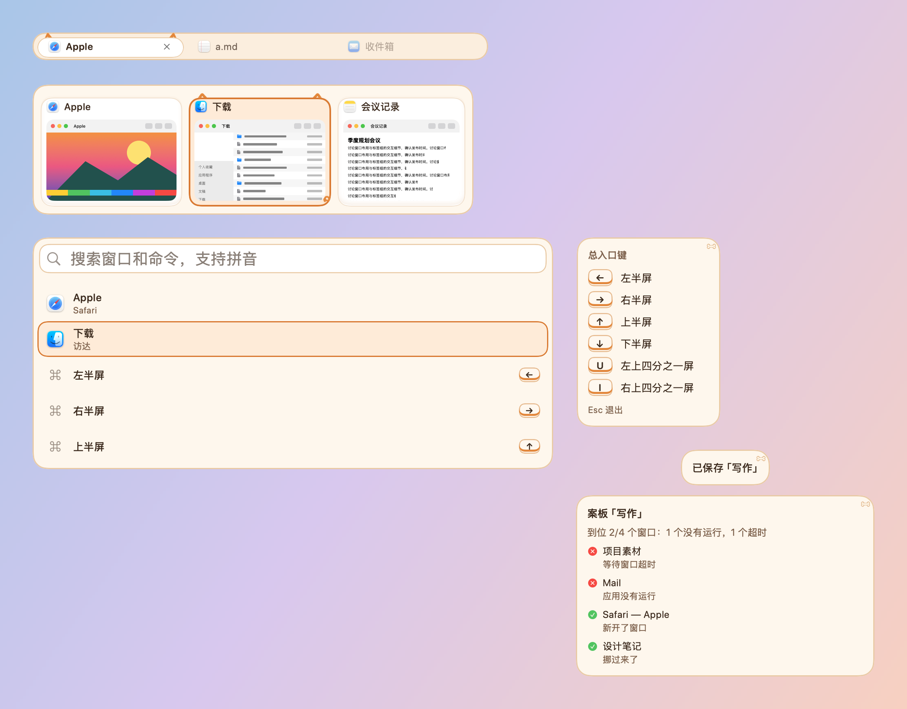

# 柴犬 · 皮肤包

格式见 `../../FORMAT.zh-CN.md`，设计见 `../../调研-可爱风格-2026-10-23.md`。柿子橙和奶油白：选中卡片竖起一对立耳，右下角甩出一截卷尾巴。

- `assets/ears.png`：选中卡片的一对立耳；`assets/tail.png`：右下角的卷尾巴（九宫格右下角，沿卡片右边的留白卷上来），选中时左右摆一下（`offset` 关键帧）；`assets/tab-ears.png`：当前标签的小立耳；`assets/sticker.png`：右上角的骨头。
- 所有素材由 `skins/make-cute-packages.py` 用 Pillow 画出：2 像素 = 1 点（`"scale": 0.5`），全部原创，CC0。
- 装饰都画在文字和缩略图下面；面板本身不往外画，面板上的装饰只放在留白里。
- 字体：系统圆体（`"design": "rounded"`），字号和粗细由各模块决定。
- 动效：选中框弹簧滑动（0.34 秒，带一点回弹），耳朵和角标从卡片后面弹上来（`pop`）；悬停原地淡入。开启“减少动态效果”时一律直接切换。
- 增强对比度：描边加粗；耳朵保留。
- 工坊可调：选中色、悬停色。图片里的耳朵颜色固定。

按本包画出的样子：

打包：在本目录执行 `zip -q -r -X ../柴犬.untangleskin . -x '.*'`。
