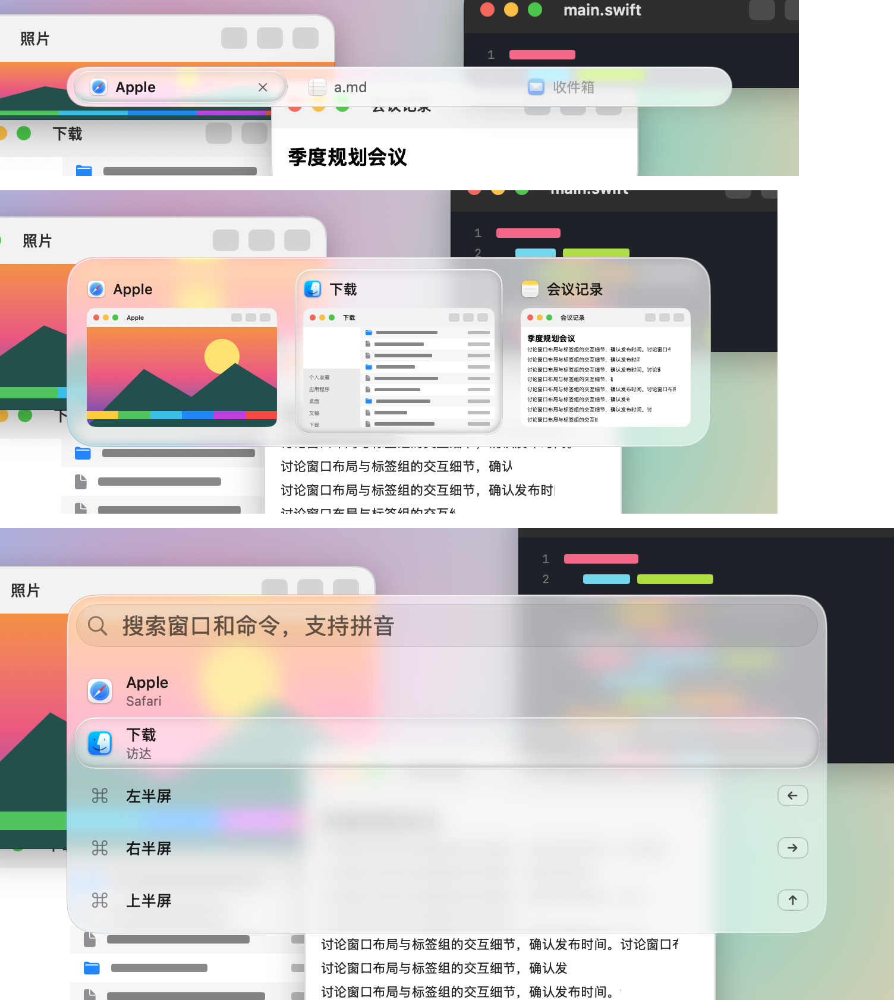
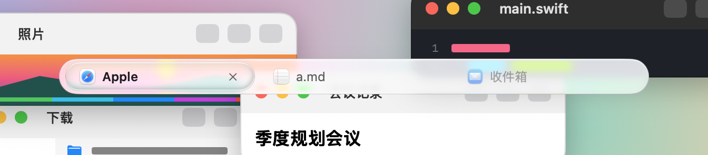
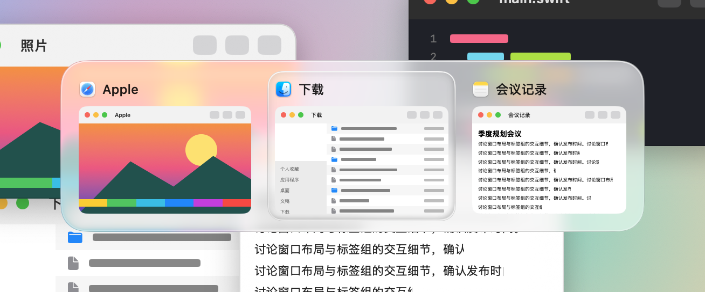
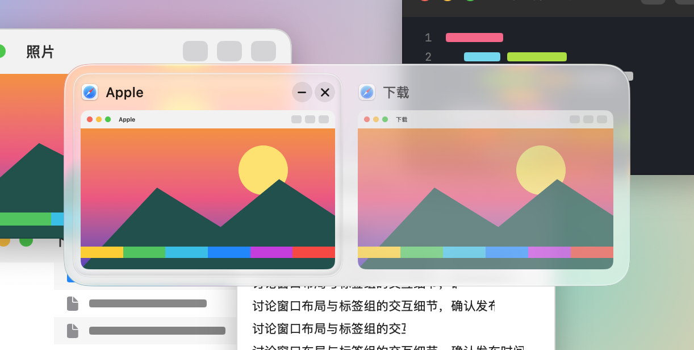
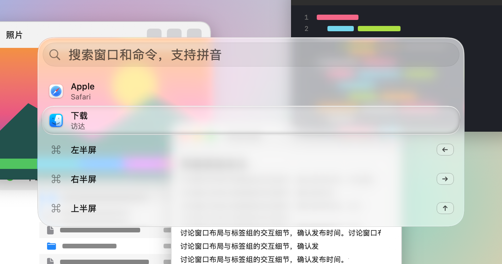
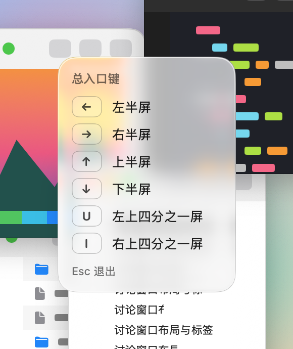
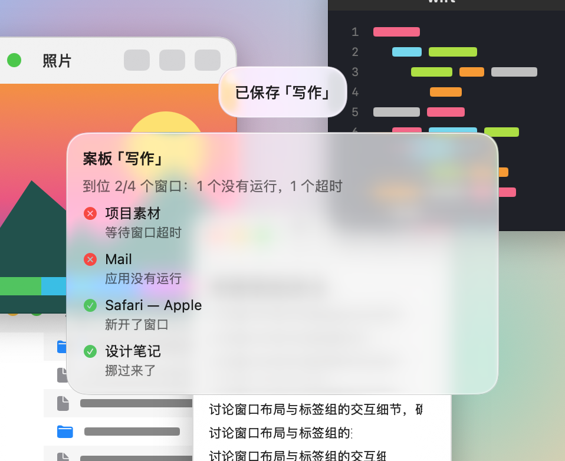

# 液态玻璃·透镜 · 2026-10-26

苹果式的液态玻璃：几乎不加白，双线亮边；选中处浮起一块明亮的透镜，在卡片、行和标签之间弹着滑过去。

依据：液态玻璃参考板的 03（macOS 27 双线边缘）、02（Spotlight）和 11（选中胶囊与选中透镜）。外壳是原生玻璃，不加白，外侧 0.5 点黑 16% 暗线，内侧 1 点亮边（顶部白 65%、底部白 30%）。

生成：`python3 skins/make-glass-packages.py`；图片：`UNTANGLE_GALLERY_DIR=<画廊> zsh scripts/gallery.sh SkinPackageGallery/glassShots`，再 `python3 skins/make-glass-packages.py --renders <画廊>`。
