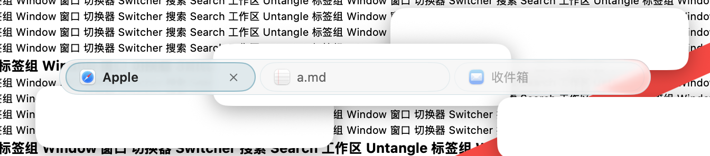
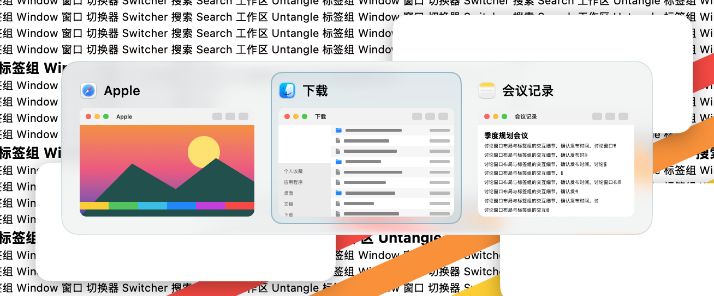
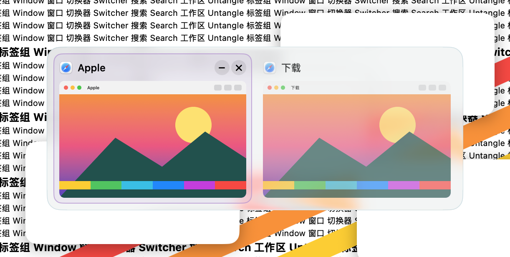
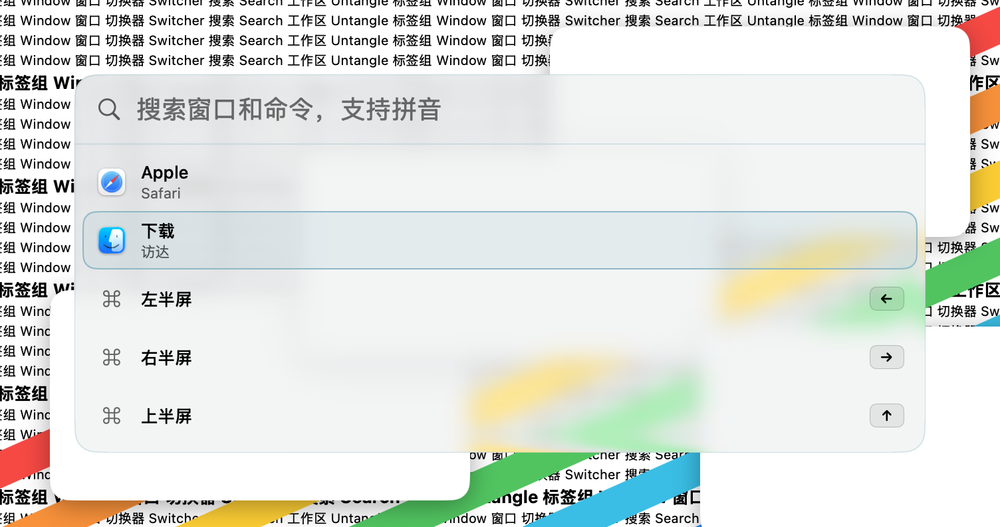
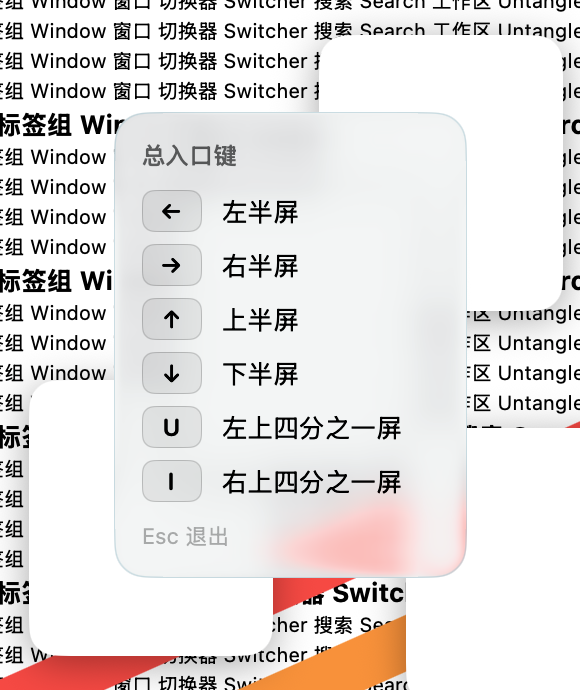
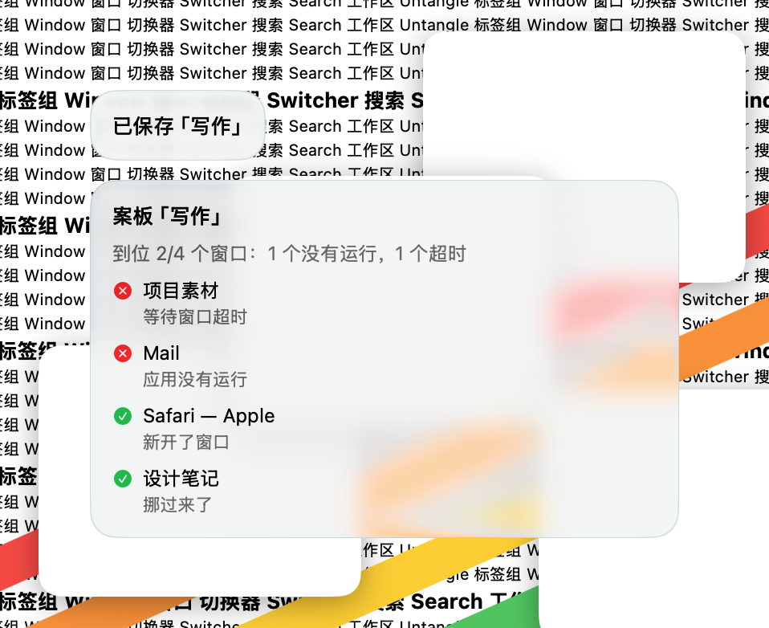

# 玻璃 · 2026-10-22

**定位**：和 macOS 26 的 Liquid Glass 融为一体，只用很轻的颜色点缀，让桌面透过来。

## 参数

| 项 | 值 |
|---|---|
| 外形 | 圆角，半径 16 |
| 强调色（选中） | `#89b9c7` 浅青 |
| 悬停色 | `#b28bd0` 淡紫 |
| 发光 | 0 |
| 背景不透明度 | 60%（叠在系统玻璃材质上的着色强度） |
| 高亮动效 | 轻柔，标准速度 |
| 选中标记 | 无（靠填充和描边） |

## 绘制

- **材质**：系统 `glassEffect`，叠一层随不透明度变化的极淡着色；标签栏的玻璃随鼠标有交互反馈。
- **文字**：系统主文字色，随深浅色模式自动切换。
- **选中**：强调色 22% 填充 + 实线描边；悬停为悬停色 14% 填充。选中框在卡片或标签间滑动。
- **增强对比度**：描边加粗到 2 点，填充和描边都用满强度。

## 截图

## 代码

模板在 `Sources/OverlayKit/TabBarTheme.swift`（`preset(.glass)`），面板绘制在 `OverlayThemeSkin.swift`、标签绘制在 `TabThemeSkin.swift` 的 glass 分支。
