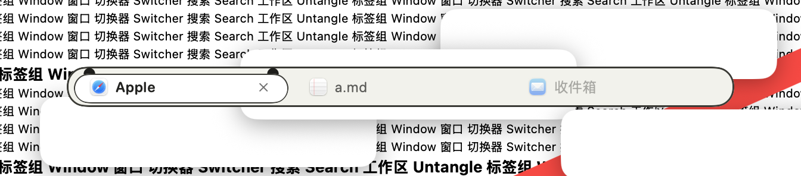
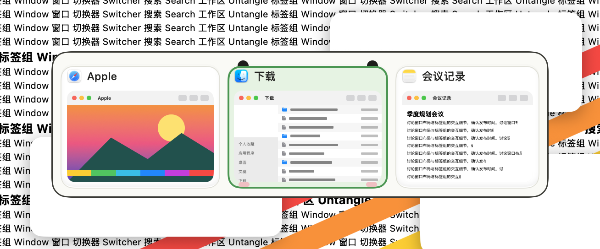
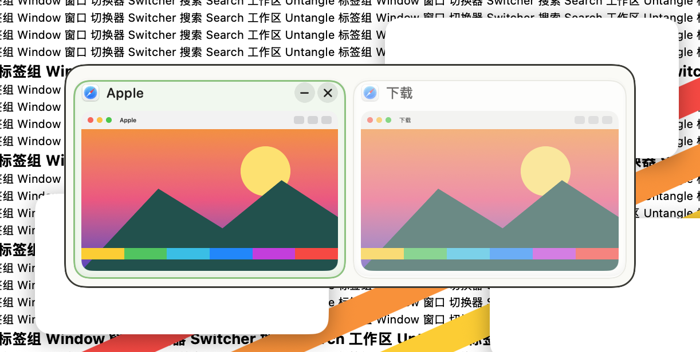
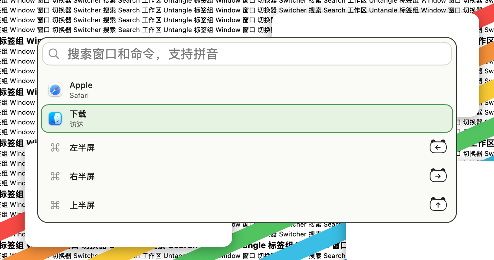
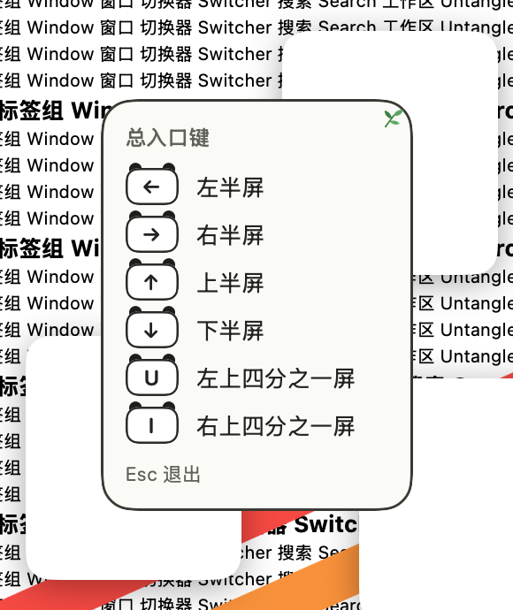
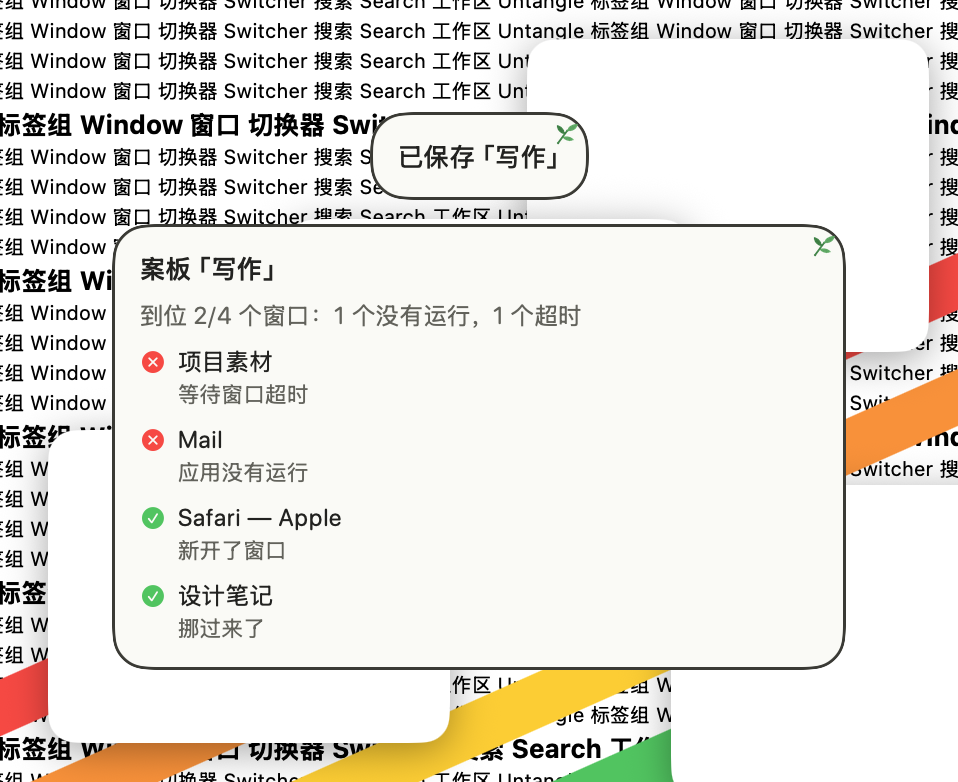

# 竹林熊猫 · 2026-10-23

**定位**：米白、墨黑、竹绿：选中的卡片变成熊猫头，键帽戴着黑色圆耳，角上一枝竹叶。只用通用的动物特征，不画、不借用任何现成角色。设计和取舍见 [可爱风格调研](../调研-可爱风格-2026-10-23.md)。

## 配色

| 项 | 值 |
|---|---|
| 面板 / 描边 | `#FAFAF6` / `#3A3A35` |
| 文字 / 次要文字 | `#222220` / `#62625B` |
| 卡片 / 缩略图底 | `#FFFFFF` / `#EFEFE8` |
| 选中描边 / 选中底色 | `#3C984E` / `#E5F3E2` |
| 悬停 | `#86C47C` |
| 标签栏 / 当前标签 | `#F2F2EC` / `#FFFFFF` |
| 键帽 / 键帽字 | `#FFFFFF` / `#222220` |
| 搜索框 / 描边 | `#FFFFFF` / `#D6D6CD` |
| 装饰 | 耳朵 `#1D1D1B`，腮红 `#F6B3BC`，竹叶 `#4FA45C` |

## 各元素

- 面板：圆角 18，米白底，1.5 点墨色描边。
- 卡片：白色；底色和描边从上沿让出 6 点。选中时变成熊猫头：两只黑色圆耳从底色后面冒出来，下边两角各一团淡粉腮红；竹绿描边配浅绿底。
- 悬停：浅竹绿细边加淡底。
- 标签：当前标签白色胶囊，两只小黑耳。
- 搜索结果：选中行是浅绿胶囊加竹绿边。
- 键帽：白色，墨色描边，戴两只黑色圆耳。
- 快捷键提示、提示浮窗：右上角一枝竹叶。
- 圆耳和腮红是 `box` 色块，工坊里能改耳朵的颜色。
- 字体：系统圆体（英文和数字是圆体，中文是苹方），字号和粗细由各模块决定。
- 动效：选中框平滑滑动（0.2 秒），装饰直接出现；悬停原地淡入（0.12 秒）。开启“减少动态效果”时一律直接切换。
- 增强对比度：描边加粗，耳朵保留。
- 装饰都画在文字和缩略图下面；面板本身不往外画，面板上的装饰只放在留白里。

## 皮肤包

`package/` 是按 [皮肤包格式](../FORMAT.zh-CN.md) 写的皮肤包，由 `make-cute-packages.py`（本地素材生成工具） 生成，打成 `.untangleskin` 后可在皮肤工坊导入。下图由 App 的皮肤包引擎读取 `package/` 画出，不是网页模拟：标签栏、切换器、搜索面板、快捷键提示和提示浮窗；当前标签、第二张卡片和第二行处于选中状态。

## 截图（App，繁杂背景）

