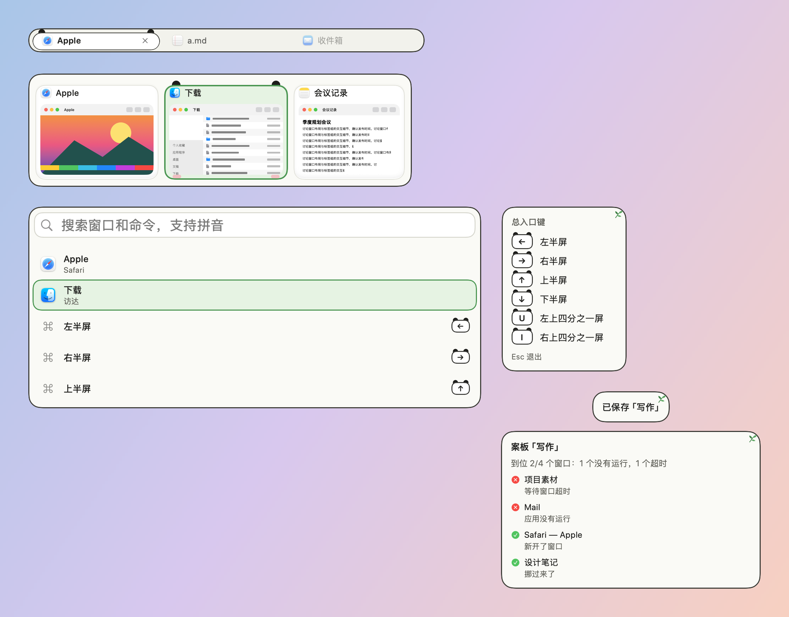

# 竹林熊猫 · 皮肤包

格式见 `../../FORMAT.zh-CN.md`，设计见 `../../调研-可爱风格-2026-10-23.md`。米白、墨黑、竹绿：选中的卡片变成熊猫头，键帽戴着黑色圆耳，角上一枝竹叶。

- 熊猫的圆耳和腮红是 `box` 圆形色块，不是图片，所以工坊里能改耳朵的颜色；`assets/sticker.png`：右上角的竹叶。
- 卡片的底色和描边从上沿往下让出 6 点，圆耳露出 6 点，不出卡片；腮红画在卡片下边的留白里。
- 所有素材由 `skins/make-cute-packages.py` 用 Pillow 画出：2 像素 = 1 点（`"scale": 0.5`），全部原创，CC0。
- 装饰都画在文字和缩略图下面；面板本身不往外画，面板上的装饰只放在留白里。
- 字体：系统圆体（`"design": "rounded"`），字号和粗细由各模块决定。
- 动效：选中框平滑滑动（0.2 秒），装饰直接出现；悬停原地淡入。开启“减少动态效果”时一律直接切换。
- 增强对比度：描边加粗；耳朵保留。
- 工坊可调：选中色、悬停色、耳朵颜色。

按本包画出的样子：

打包：在本目录执行 `zip -q -r -X ../竹林熊猫.untangleskin . -x '.*'`。
