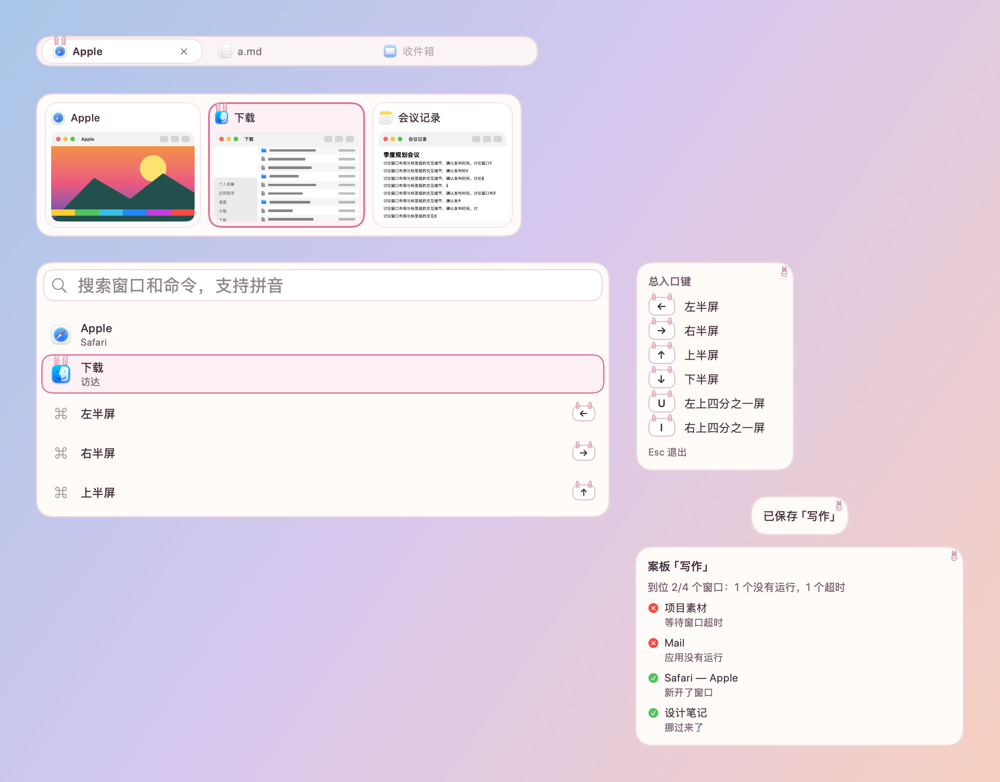

# 草莓兔 · 皮肤包

格式见 `../../FORMAT.zh-CN.md`，设计见 `../../调研-可爱风格-2026-10-23.md`。奶白和草莓粉：选中窗口的图标长出一对白色兔耳，键帽也戴着长耳朵。

- `assets/ears.png`：选中卡片上，窗口图标长出的一对兔耳（九宫格左上角，26 × 12 点，画在选中底色之上、内容之下，耳根藏在图标后面）；`assets/row-ears.png`：选中的搜索结果里图标上的兔耳；`assets/tab-ears.png`：当前标签图标上的兔耳，耳尖伸出标签 3 点；`assets/key-ears.png`：键帽两个上角的长耳朵，伸出 4 点、再伸进键帽上沿 3 点；`assets/sticker.png`：快捷键提示和提示浮窗右上角的小兔子头。
- 耳朵按图标的位置画：卡片的图标在 (7, 9)、16 点，搜索结果的在 (10, 10)、24 点，标签的在左边 13 点、16 点。设置里隐藏图标时，耳朵仍画在原处。
- 沿用垂耳兔的包 id（`io.untangle.lop-bunny`），版本 1.1.0，装上会替换原来的垂耳兔。
- 所有素材由 `skins/make-cute-packages.py` 用 Pillow 画出：2 像素 = 1 点（`"scale": 0.5`），全部原创，CC0。
- 装饰都画在文字和缩略图下面；面板本身不往外画，面板上的装饰只放在留白里。
- 字体：系统圆体（`"design": "rounded"`），字号和粗细由各模块决定。
- 动效：选中框弹簧滑动（0.34 秒，带一点回弹），耳朵和角标从卡片后面弹上来（`pop`）；悬停原地淡入。开启“减少动态效果”时一律直接切换。
- 增强对比度：描边加粗；耳朵保留。
- 工坊可调：选中色、悬停色。图片里的耳朵颜色固定。

按本包画出的样子：

打包：在本目录执行 `zip -q -r -X ../草莓兔.untangleskin . -x '.*'`。
