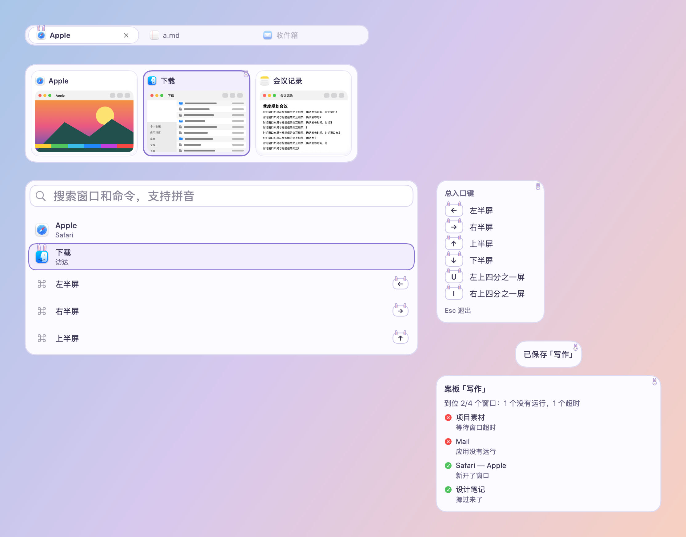
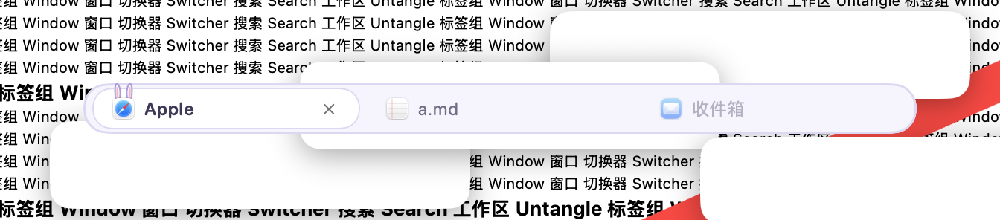
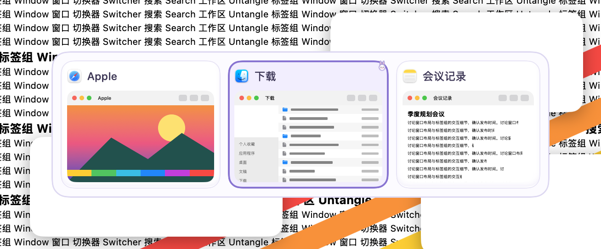
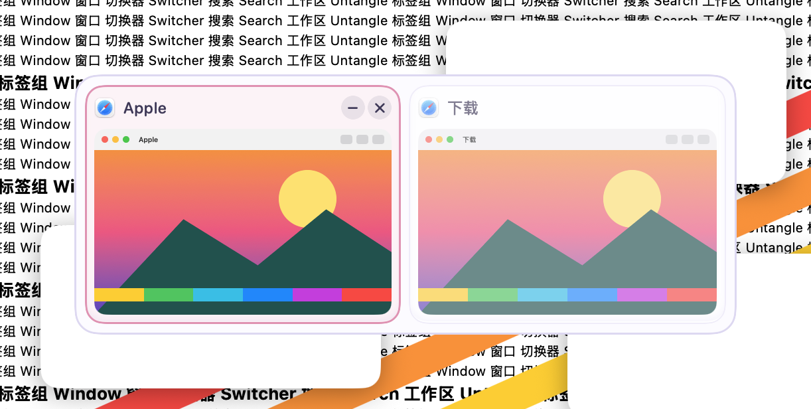
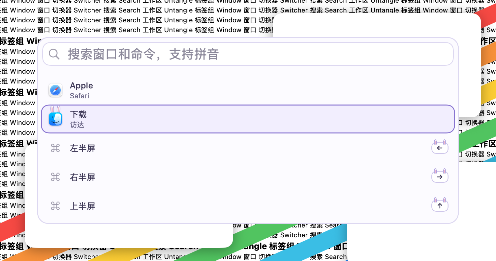
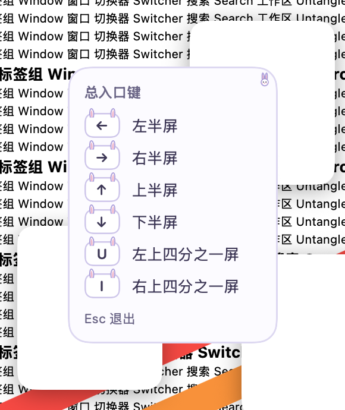
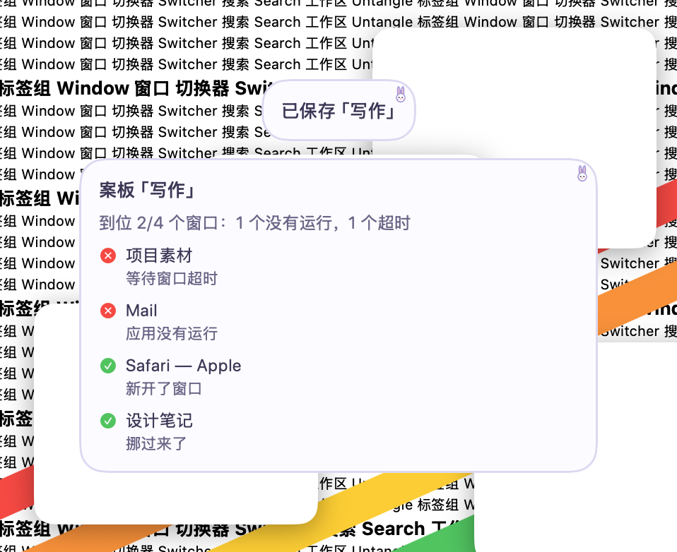

# 薰衣草兔 · 2026-10-23

**定位**：奶白和薰衣草紫：选中卡片角上探出一只小兔子头，标签和搜索结果的图标戴着兔耳。只用通用的动物特征，不画、不借用任何现成角色。设计和取舍见 [可爱风格调研](../调研-可爱风格-2026-10-23.md)。

## 配色

| 项 | 值 |
|---|---|
| 面板 / 描边 | `#FCFBFF` / `#DED8F2` |
| 文字 / 次要文字 | `#3F3858` / `#6C6688` |
| 卡片 / 缩略图底 | `#FFFFFF` / `#F3F1FA` |
| 选中描边 / 选中底色 | `#8B73D4` / `#F2EEFF` |
| 悬停 | `#E58FB2` |
| 标签栏 / 当前标签 | `#F6F4FD` / `#FFFFFF` |
| 键帽 / 键帽字 | `#FFFFFF` / `#3F3858` |
| 搜索框 / 描边 | `#FFFFFF` / `#DED8F2` |
| 装饰 | 兔耳 `#FFFFFF`，内耳 `#F5B9CF`，耳边 `#A898D6`，鼻子 `#F28DB0` |

## 各元素

- 面板：圆角 18，带一点紫的奶白底，1.5 点淡紫描边。
- 卡片：白色；选中时淡紫底、2 点薰衣草紫边，右上角探出一只小兔子头，在标题文字上方。
- 悬停：粉色细边加淡底。
- 标签：当前标签白色胶囊，图标上立着一对兔耳。
- 搜索结果：选中行淡紫胶囊加紫边，图标上立着一对兔耳。
- 键帽：白色键帽，戴两只长耳朵。
- 快捷键提示、提示浮窗：右上角一只小兔子头。
- 字体：系统圆体（英文和数字是圆体，中文是苹方），字号和粗细由各模块决定。
- 动效：选中框弹簧滑动（0.34 秒，带一点回弹），耳朵和角标从卡片后面弹上来；悬停原地淡入（0.12 秒）。开启“减少动态效果”时一律直接切换。
- 增强对比度：描边加粗，耳朵保留。
- 装饰都画在文字和缩略图下面；面板本身不往外画，面板上的装饰只放在留白里。

## 皮肤包

`package/` 是按 [皮肤包格式](../FORMAT.zh-CN.md) 写的皮肤包，由 `make-cute-packages.py`（本地素材生成工具） 生成，打成 `.untangleskin` 后可在皮肤工坊导入。下图由 App 的皮肤包引擎读取 `package/` 画出，不是网页模拟：标签栏、切换器、搜索面板、快捷键提示和提示浮窗；当前标签、第二张卡片和第二行处于选中状态。

## 截图（App，繁杂背景）

