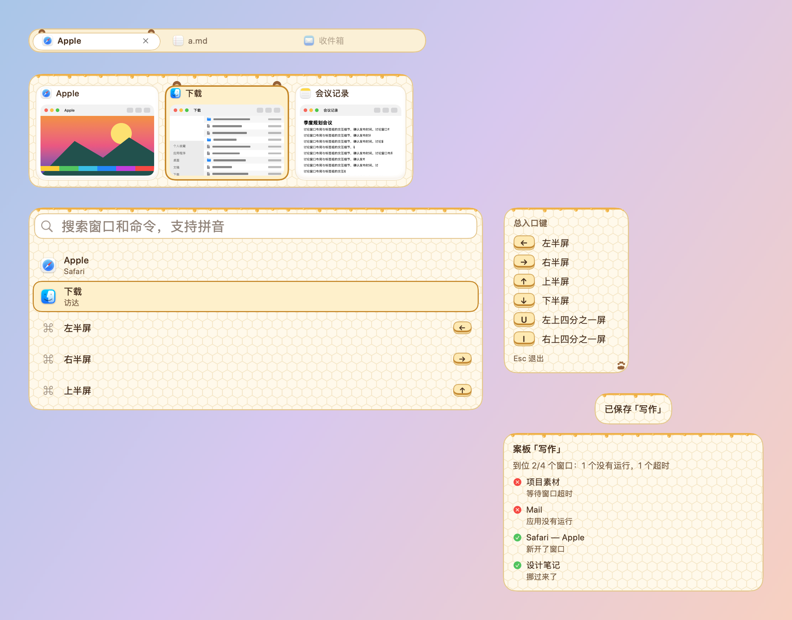

# 蜂蜜小熊 · 皮肤包

格式见 `../../FORMAT.zh-CN.md`，设计见 `../../调研-可爱风格-2026-10-23.md`。奶油、蜂蜜黄和焦糖棕：选中卡片冒出一对圆耳，面板上沿淌着蜂蜜，底纹是淡淡的蜂巢。

- 熊耳（外耳和内耳）是 `box` 圆形色块，工坊里能改颜色；`assets/glaze.png`：面板上沿的蜂蜜，一张 88 × 1024 点的透明图只在最上面画了一条蜂蜜，`tile` 平铺后就沿上边重复；`assets/comb.png`：蜂巢底纹（平铺）；`assets/sticker.png`：快捷键提示右下角的熊掌印。
- 增强对比度时去掉蜂巢底纹，蜂蜜保留。标签栏的留白只有 3 点，不画蜂蜜。
- 所有素材由 `skins/make-cute-packages.py` 用 Pillow 画出：2 像素 = 1 点（`"scale": 0.5`），全部原创，CC0。
- 装饰都画在文字和缩略图下面；面板本身不往外画，面板上的装饰只放在留白里。
- 字体：系统圆体（`"design": "rounded"`），字号和粗细由各模块决定。
- 动效：选中框弹簧滑动（0.34 秒，带一点回弹），耳朵和角标从卡片后面弹上来（`pop`）；悬停原地淡入。开启“减少动态效果”时一律直接切换。
- 增强对比度：描边加粗；耳朵保留。
- 工坊可调：选中色、悬停色、耳朵颜色。

按本包画出的样子：

打包：在本目录执行 `zip -q -r -X ../蜂蜜小熊.untangleskin . -x '.*'`。
