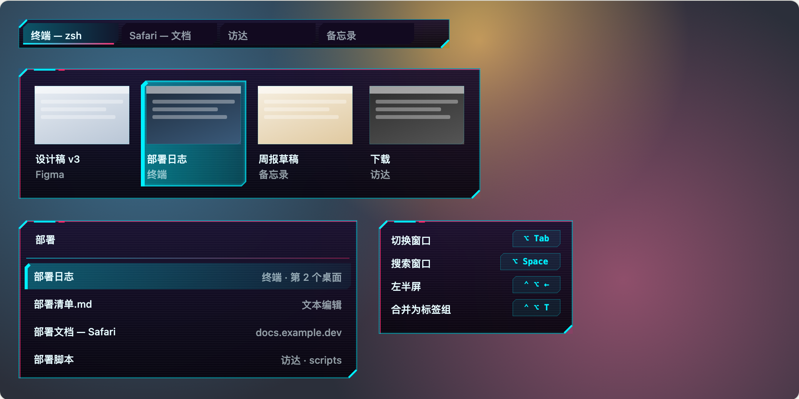
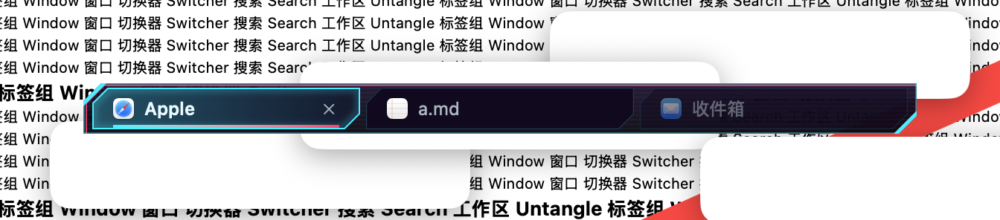
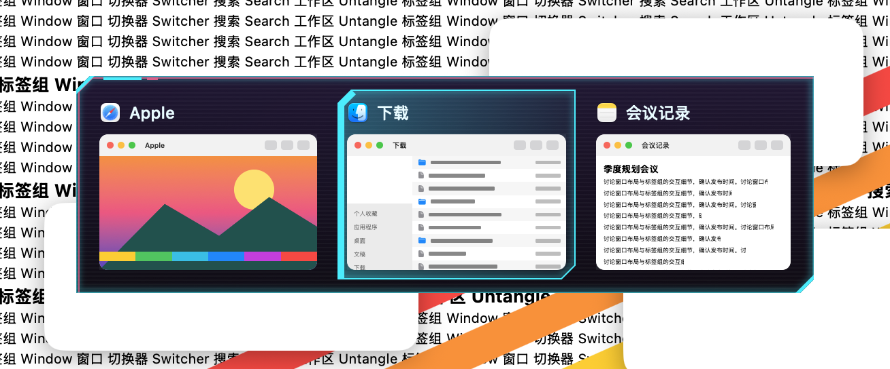
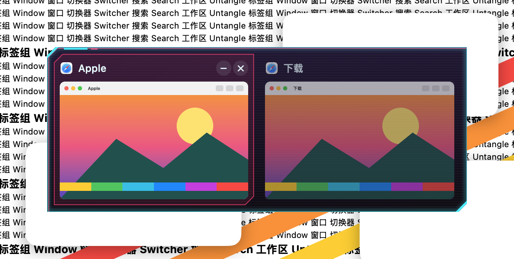
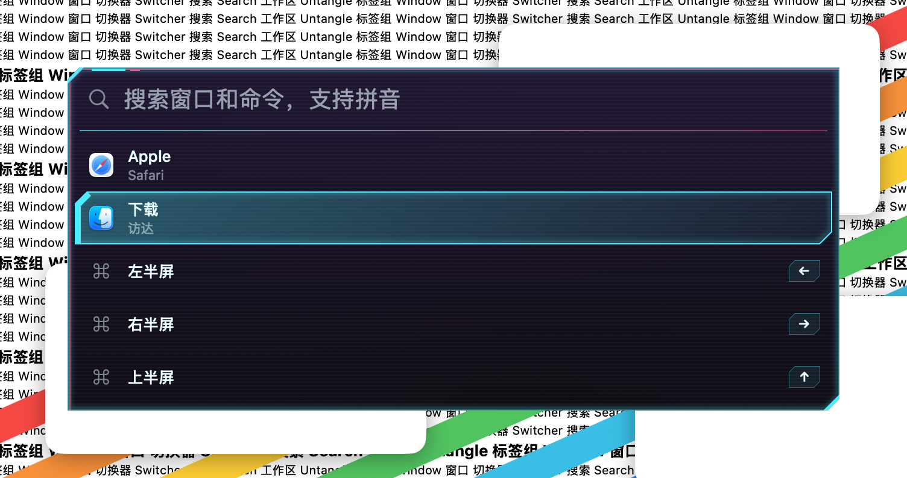
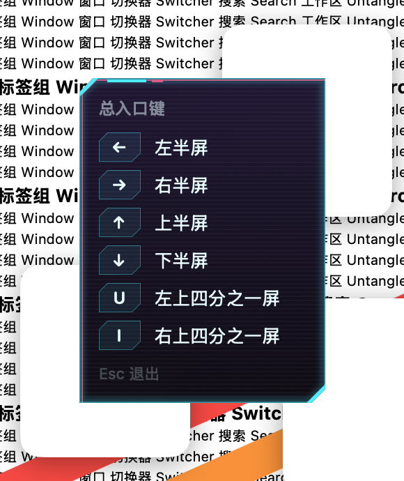
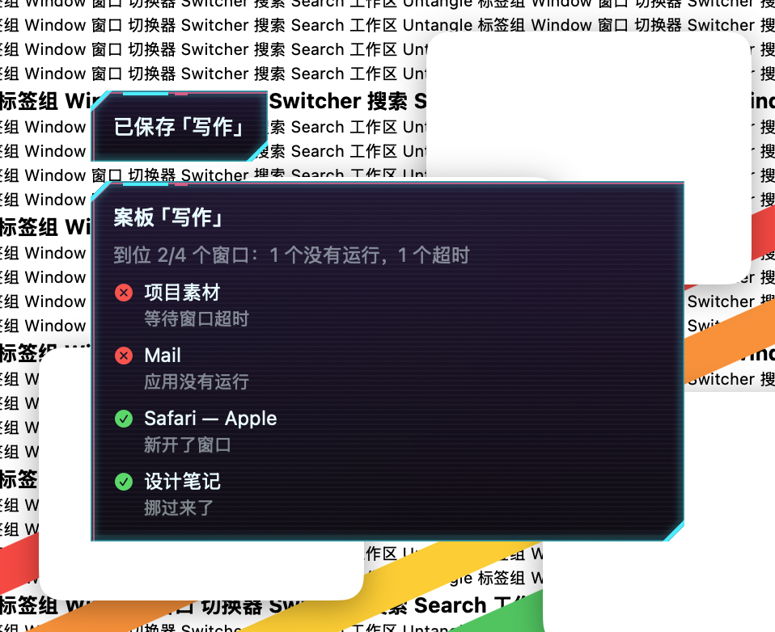

# 赛博朋克 · 2026-10-23

**定位**：夜色里的霓虹终端。近黑带紫的底、青与洋红撞色、斜切的角和扫描线，像 HUD 一样有存在感，但文字始终清楚。

替代 2026-10-22 的第一版（灰蓝底、青色细描边，紫色几乎看不见、整体像普通暗色主题）。

## 参数

| 项 | 值 |
|---|---|
| 外形 | 切角，10 点；也适配平行四边形（按倾角绘制） |
| 强调色（选中） | `#00f0ff` 霓虹青 |
| 次要色（悬停、错位描边、色条） | `#ff2a6d` 洋红 |
| 底色 | 自上而下 `#1a0f2e` → `#07040d` 渐变；标签 `#120a20` |
| 文字 | `#e6fbff` |
| 发光 | 55 |
| 背景不透明度 | 94% |
| 高亮动效 | 轻柔，标准速度 |
| 选中标记 | 面板：左侧色条；标签：底部下划线（青 → 洋红渐变） |

## 绘制

- **底**：上浅下深的近黑紫渐变，叠每 3 点一条、3.5% 白的静态扫描线。
- **边**：青色细描边；洋红描边向右下错开 1.5、1 点，像信号重影；斜切的角用青色实线点亮。
- **HUD 标签**：浮层面板左上角，切角之后一段 28 点青条 + 8 点洋红条。
- **选中**：从左边缘的青色向右渐淡的填充 + 沿左边缘（随切角或倾斜）的实心色条 + 内收发光。
- **悬停**：洋红描边与淡洋红填充。
- **搜索框分隔线、快捷键键帽**：青 → 洋红渐变线、带青色淡底的键帽。
- **配色固定为深色**：面板内的系统控件按深色绘制。
- **增强对比度**：去掉扫描线和错位描边，选中用满强度，文字不用自定义色。

## 皮肤包渲染

`package/` 是按 [皮肤包格式](../FORMAT.zh-CN.md) 写成的示例包。下图由网页预览器直接读取 `package/skin.json` 画出，不是 App 截图：标签栏、切换器、搜索面板、快捷键提示；当前标签、第二张卡片和第一行处于选中状态。

## 截图（App）

## 代码

`Sources/OverlayKit/CyberpunkSkin.swift`（底、边、HUD 标签、选中渐变、切角形状），模板在 `TabBarTheme.swift`（`preset(.cyberpunk)`），选中标记在 `SelectionMarker.swift`。
